# Codyssey 개발 입문 미션 1-1

내 컴퓨터에 개발자용 작업실을 구성하고 Linux CLI, 파일 권한, Docker, Git을 실습하는 프로젝트입니다. Dockerfile 기반 정적 웹 서버를 만들고 포트 매핑, Bind Mount, Named Volume의 동작을 확인하는 것을 목표로 합니다.

## 실행 환경 및 검증 기준

- 사용자 제공 환경: Windows 11 + WSL2 Ubuntu + Docker Desktop, VS Code + WSL 확장
- 작업 경로: `/path/to/mission-1-1`
- 기본 브랜치: `main` (사용자 제공 정보)
- Docker Desktop에서 WSL2 엔진과 해당 Ubuntu 배포판의 WSL 통합이 활성화되어 있어야 합니다.
- 명령어는 **재현 안내**, **셸 history 발췌**, **이번 파일 조회 결과**로 구분합니다. 재현 안내는 실행 증거가 아니며, history에는 성공 여부를 판단할 출력이 없습니다. 이번 문서 정리에서 Docker 실행·중지·삭제 및 Git add·commit·push는 수행하지 않았습니다.
- 실제 출력·파일로 확인한 사실과 사용자 보고·명령 이력을 구분합니다. 각 이미지의 확인 범위를 캡션에 표시하며, 개인정보 마스킹과 최종 GitHub 반영 점검은 남아 있습니다.

### 공식 기준 및 추가 실습 자료

공식 기준은 [사용자 제공 미션 원문](mission-requirements.md)의 2·4·7절이며, 5절 보너스는 필수와 구분합니다.

- [추가 명령어 이력](evidence/cli-docker-command-history.txt): history 134~160번. 명령 입력 기록이며 실행 출력은 포함하지 않습니다.
- [CLI 실습 파일](cli-evidence-practice/practice-empty.txt): 현재 28바이트입니다. 이름과 달리 현재 빈 파일은 아니며, 과거 `touch` 수행 여부는 별도 로그로 확인해야 합니다.
- [직접 작성 실습 Dockerfile](dockerfile-manual-practice/Dockerfile), [정적 HTML](dockerfile-manual-practice/index.html)

환경 증빙의 실제 출력에서 WSL 호스트 Ubuntu 26.04.1 LTS, Bash(`/bin/bash`), Docker CLI·서버 29.9.2, Git 2.53.0을 확인했습니다. 기존 Ubuntu 24.04 컨테이너와 호스트 OS 버전은 서로 다른 환경입니다. 터미널은 VS Code 통합 터미널 사용 화면이 있습니다.


### 개인 경로를 바꾸어 재현하는 방법

아래 기존 절의 `/path/to/mission-1-1`은 작성자 작업 경로입니다. 평가자는 저장소를 clone한 실제 위치를 사용하고 그 경로를 모든 `cd` 명령에 일관되게 대체합니다. Docker Desktop의 해당 WSL 배포판 통합을 켜고 WSL 터미널에서 실행합니다. 같은 이름의 컨테이너·파일이나 점유된 포트가 있으면 새 이름·빈 포트를 사용하며, 기존 자원을 임의 삭제하지 않습니다.

```bash
# 재현 안내: 원하는 상위 폴더에서 저장소가 아직 없을 때
git clone https://github.com/inyoung7-lab/ia-codyssey-allinone-test1-1.git
cd ia-codyssey-allinone-test1-1
pwd
```

후속 상대경로는 이 프로젝트 루트를 기준으로 합니다.

## 프로젝트 구성

```text
mission-1-1/
├── .gitignore
├── README.md
├── practice.txt
├── permission-test/
│   ├── hello.txt
│   └── hello-renamed.txt
├── bind-mount/
│   └── shared.txt
└── web-server/
    ├── Dockerfile
    ├── .dockerignore
    └── index.html
```

`evidence/`의 PNG 증빙은 아래 관련 실습 절에서 각각 한 번씩 참조합니다. 최종 개수는 하단 체크리스트에 기록합니다. 이미지를 직접 확인하여 배치했으며, 재현 안내 명령어와 당시 실행 화면의 이름·입력값이 다른 경우 캡션으로 구분합니다.

## 1. Linux 명령어와 경로

사용자는 기본 CLI 실습을 수행했습니다. 아래에서 실제 결과가 있는 조회 화면과 명령 이력만 있는 생성·복사·이동 기록을 구분합니다.

다음 명령어는 기존 파일과 구분한 `cli-replay/`에서 한 번씩 수행하는 재현 예시입니다. 같은 폴더가 이미 있다면 먼저 내용을 확인하고 다른 이름을 사용합니다.

```bash
cd /path/to/mission-1-1
pwd
ls
ls -la
mkdir cli-replay
cd cli-replay
touch practice.txt
echo 'Hello Codyssey' > hello.txt
cat hello.txt
cp hello.txt hello-copy.txt
mv hello-copy.txt hello-renamed.txt
cd ..
```

- 절대경로: `/path/to/mission-1-1`처럼 `/`에서 시작합니다.
- 상대경로: 현재 위치를 기준으로 하는 `cli-replay/hello.txt` 등입니다.
- `.`은 현재 디렉터리, `..`은 상위 디렉터리입니다.

**증빙:** VS Code 터미널의 출력 확인 화면입니다. CLI 전체 명령어 수행 이력을 증명하는 화면은 아닙니다.

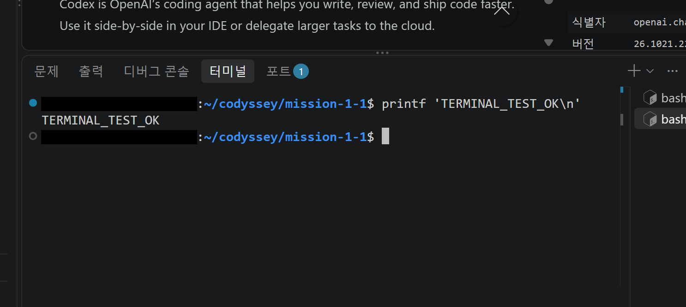

### 추가 CLI 수행 기록의 확인 범위

`cli-evidence-practice/`에서의 명령 이력과 새 조회 결과를 연결했습니다. 새 화면은 `cd`, `pwd`, `ls -la`, `cat`의 입력과 출력, 실제 파일 내용을 보여줍니다. 생성·빈 파일·복사·이동의 당시 결과는 history만으로 확정하지 않습니다. 삭제 확인 질문 화면도 실제 삭제 완료 응답은 포함하지 않습니다.

```bash
# history 발췌: 원본 번호 134~135, 출력 없음
rm -i practice-renamed.txt
ls -l
```

삭제 확인 질문에 대한 응답과 삭제 후 목록은 이력에 없습니다. 파일 존재만으로 복사·이동·삭제 성공을 확정하지 않습니다.


## 2. 파일·디렉터리 권한

`r`은 읽기, `w`는 쓰기, `x`는 실행 권한입니다. 디렉터리에서는 `r`이 항목 목록 읽기, `w`가 항목 생성·삭제, `x`가 내부 접근을 뜻합니다. 항목 생성·삭제에는 일반적으로 디렉터리의 `w`와 `x`가 함께 필요합니다.

권한 숫자는 소유자·그룹·기타 사용자 순서이고, `r=4`, `w=2`, `x=1`을 더합니다.

| 권한 | 의미 |
| --- | --- |
| `644` | 소유자 읽기·쓰기, 그룹과 기타 사용자 읽기 |
| `755` | 소유자 읽기·쓰기·실행, 그룹과 기타 사용자 읽기·실행 |

사용자는 파일 `644 → 755 → 644`, 디렉터리 `755 → 644 → 755` 변경을 수행했다고 보고했습니다. 문서 작성 시 `practice.txt`와 두 hello 파일은 `644`, `permission-test/`는 `755`로 확인했습니다. 중간 변경 과정은 미검증입니다.

```bash
# 앞 절에서 만든 재현용 파일과 폴더 사용
chmod 644 cli-replay/hello.txt
ls -l cli-replay/hello.txt
chmod 755 cli-replay/hello.txt
ls -l cli-replay/hello.txt
chmod 644 cli-replay/hello.txt
chmod 644 cli-replay
ls -ld cli-replay
# 디렉터리의 x 권한을 없애면 내부 파일 접근이 제한됩니다.
chmod 755 cli-replay
ls -ld cli-replay
```

**증빙:** 파일의 최종 `644`와 디렉터리의 최종 `755` 상태입니다. 권한 변경 중간 과정과 접근 제한 결과는 이 두 이미지로 확인할 수 없습니다.

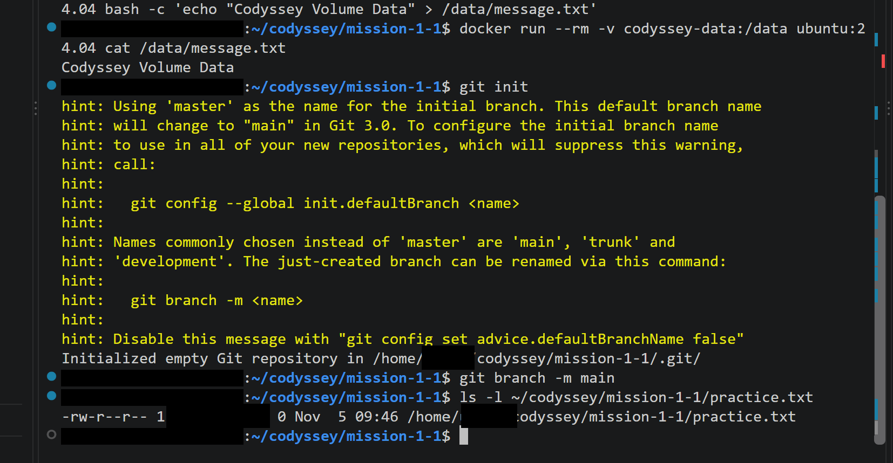

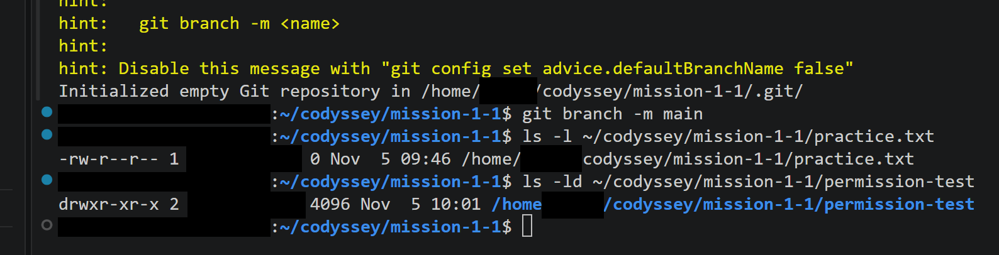

CLI 증거는 역할을 나누어 읽습니다. `linux-cli-command-history.png`는 생성·복사·이동·삭제 명령 입력, `linux-cli-execution-results.png`는 위치·목록·내용의 실제 결과입니다. `file-permission-644-list.png`는 남아 있는 파일 목록이고 `cli-remove-confirmation-prompt.png`는 삭제 확인 질문입니다. 이 자료만으로 복사 직후 동일성·이름 변경 직후 목록·삭제 응답을 새로 만들어 설명하지 않습니다.

### 추가 파일·디렉터리 권한 실습

```bash
# history 발췌: 원본 번호 136~144, 출력 없음
stat -c '%a %A %n' practice-empty.txt
chmod 600 practice-empty.txt
stat -c '%a %A %n' practice-empty.txt
chmod 644 practice-empty.txt
stat -c '%a %A %n' practice-empty.txt
stat -c '%a %A %n' .
chmod 700 .
stat -c '%a %A %n' .
chmod 755 . && stat -c '%a %A %n' .
```

사용자 보고와 파일 배치를 기준으로 작업 대상은 `cli-evidence-practice/`로 연결됩니다. history 자체에는 진입 명령과 조회 출력이 없습니다. `600`은 소유자 읽기·쓰기만, `700`은 소유자 읽기·쓰기·실행만 허용합니다.

이번 문서 정리에서 `stat -c '%a %A %s %n'`으로 읽기 전용 조회한 결과:

```text
755 drwxr-xr-x 4096 cli-evidence-practice
644 -rw-r--r-- 28 cli-evidence-practice/practice-empty.txt
```

파일의 `644→600→644` 상태를 기존 이미지와 아래 실제 출력으로 확인했습니다. 별도 `permission-demo` 디렉터리의 `755→700→755`는 새 화면에 각 명령과 결과가 함께 있어 검증을 완료했습니다. 기존 `directory-permission-755-stat.png`는 실습 폴더 자체의 755 상태이며 새 디렉터리와 대상을 구분합니다.


## 3. Docker 준비 및 기본 컨테이너

Windows에서 Docker Desktop을 실행한 뒤 VS Code의 WSL Ubuntu 터미널에서 확인합니다.

```bash
docker --version
docker version
docker info
docker run --name codyssey-hello hello-world
docker ps -a
docker logs codyssey-hello
```

`docker --version`은 CLI 버전, `docker version`과 `docker info`는 서버 연결 상태도 확인합니다. 관련 실제 실행 화면은 이 절의 증빙 이미지에서 확인합니다. 환경 절의 새 화면에서 Docker CLI·서버 버전을 확인했습니다.

Ubuntu 대화형 컨테이너:

```bash
docker run -it --name codyssey-ubuntu ubuntu:24.04 bash
# 아래는 컨테이너 안에서 실행
cat /etc/os-release
pwd
ls -la
echo 'Hello from Ubuntu container'
exit
# 아래는 WSL 호스트에서 실행
docker ps -a
```

기본 이미지·컨테이너 운영 명령어:

```bash
docker images
docker ps
docker ps -a
docker inspect codyssey-ubuntu
docker start -ai codyssey-ubuntu
# 컨테이너 안에서 exit 후, 더 이상 필요 없을 때만 삭제
docker rm codyssey-ubuntu
```

정지에는 `docker stop <컨테이너이름>`, 불필요한 이미지 삭제에는 `docker rmi <이미지이름:태그>`를 사용합니다. 컨테이너 삭제는 컨테이너 내부 데이터를 잃을 수 있으므로 실습 증거를 먼저 보관합니다.

**증빙 위치:** Docker CLI·서버 버전, hello-world 실제 출력, Ubuntu 내부 명령어와 종료 후 상태.

아래는 실제 실행 화면입니다. hello-world는 재현 예시의 고정 이름 없이 실행된 기록입니다. 재시작 후 파일 확인은 같은 컨테이너의 파일 유지 증거이며, Named Volume 증거와 구분합니다. Docker 정보 이미지는 서버 정보의 하단 부분으로, CLI·서버 버전 전체를 보여주지는 않습니다.

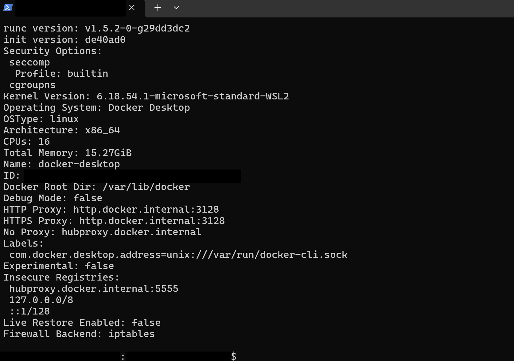

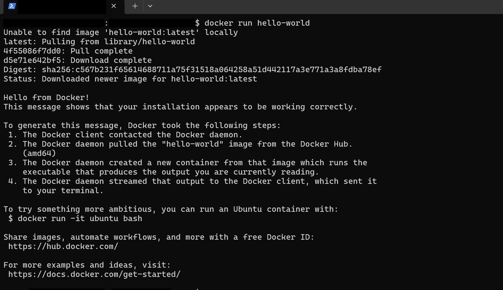

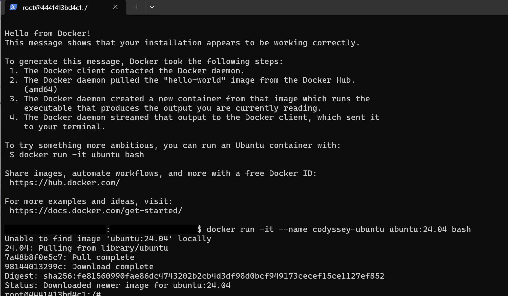

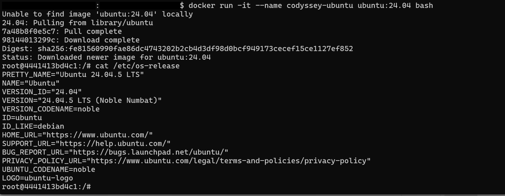

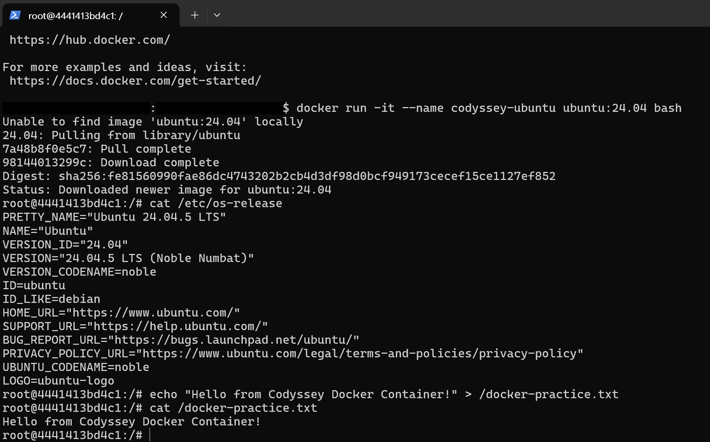

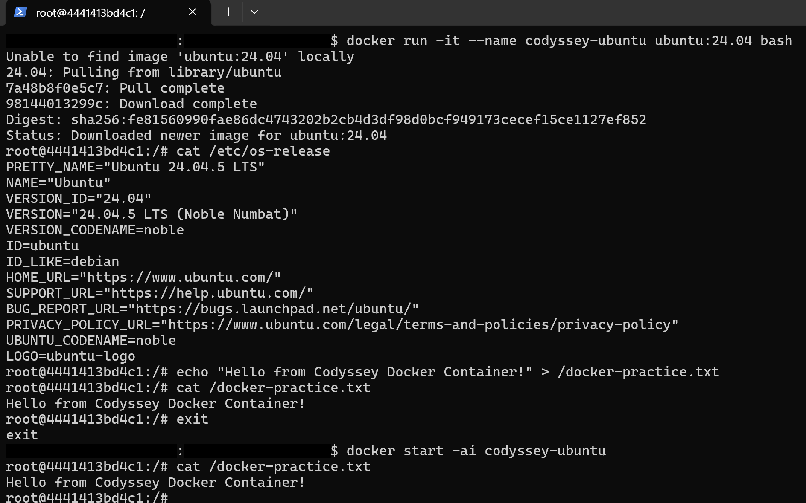

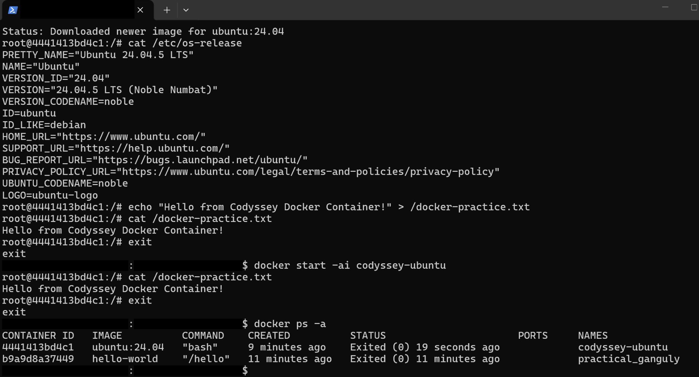

### 추가 Docker 운영 실습 및 종료·유지 설명

새 증빙에서 이미지 목록, 컨테이너 목록, Nginx 로그와 리소스 사용량 출력을 확인했습니다. 목록에는 `codyssey-stop-test`가 `Exited (137)`로 표시됩니다. `docker stop` 입력은 이력에 있으나 중지 명령의 반환 출력·전후 비교는 별도 확보되지 않아 직접 중지 성공을 단정하지 않습니다. 로그의 `/` 요청은 200, `/favicon.ico`는 404입니다. 아이콘 누락과 본문 제공 성공을 구분합니다.

Ubuntu에서 Bash가 주 프로세스인 경우 `exit`로 Bash를 끝내면 컨테이너도 정지합니다. 기존 재시작 화면의 `docker start -ai`는 같은 컨테이너를 다시 시작하여 연결한 것입니다. `docker exec`는 실행 중인 컨테이너에 추가 프로세스를 실행하므로 그 명령이 끝나도 주 프로세스가 살아 있으면 컨테이너는 유지됩니다. 기존 파일 유지 증거와 Named Volume의 컨테이너 삭제 후 데이터 유지는 구분합니다.


중지 증거는 기존 `docker-operations-command-history.png`의 `docker stop codyssey-stop-test` 입력과 `docker-images-containers-results.png`의 종료 상태를 함께 참조합니다. 종료 상태만으로 종료 원인을 확정하지 않습니다. 공식 요구사항은 중지 명령·결과 기록이며 특정 전후 캡처 형식을 별도로 지정하지 않습니다.

## 4. Dockerfile 기반 Nginx 웹 서버와 포트 매핑

확인된 `web-server/Dockerfile`의 주요 설정입니다.

```dockerfile
FROM nginx:alpine
COPY index.html /usr/share/nginx/html/index.html
EXPOSE 80
```

HTML에는 `Codyssey Docker Web Server` 제목과 `Dockerfile로 만든 첫 번째 웹 서버입니다.` 설명이 있습니다. `.dockerignore`는 HTML만 빌드 컨텍스트에 포함하도록 설정되어 있습니다.

```bash
cd /path/to/mission-1-1
docker build -t codyssey-web:1.0 ./web-server
docker run -d --name codyssey-web -p 127.0.0.1:8080:80 codyssey-web:1.0
docker ps
docker port codyssey-web
docker logs codyssey-web
curl -i http://localhost:8080
```

Windows 브라우저에서 `http://localhost:8080`에 접속합니다. `8080`은 호스트 포트, `80`은 컨테이너 Nginx 포트입니다. `EXPOSE 80`만으로 호스트에 포트가 공개되지는 않으며 `-p`가 연결을 만듭니다. 브라우저 주소창과 페이지 제목·설명이 함께 보이도록 촬영합니다.

**증빙 위치:** 빌드 성공 로그, 컨테이너 상태·포트, HTTP 응답, 주소창이 포함된 웹페이지.

실제 화면은 `codyssey-web:v1` 이미지와 `codyssey-web-server` 컨테이너를 사용합니다. 위 재현 예시의 `codyssey-web:1.0`, `codyssey-web`, 로컬 주소 바인딩과 이름·옵션이 다릅니다.

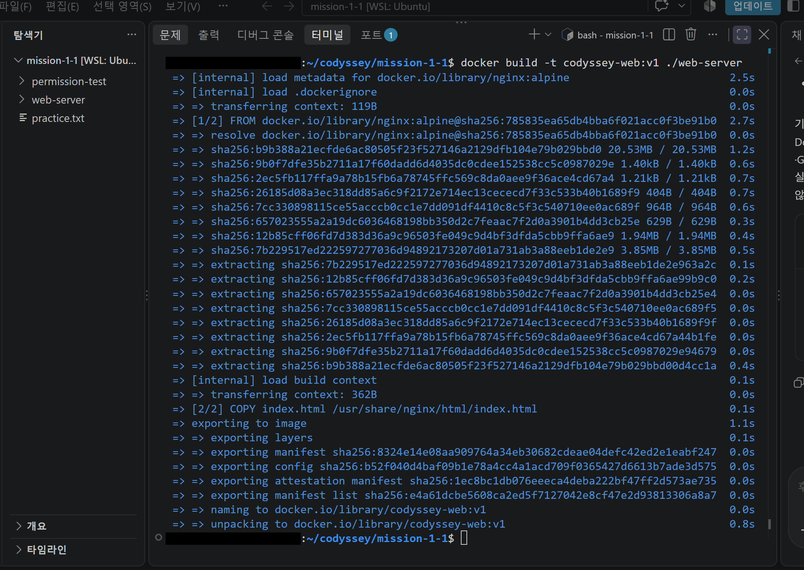

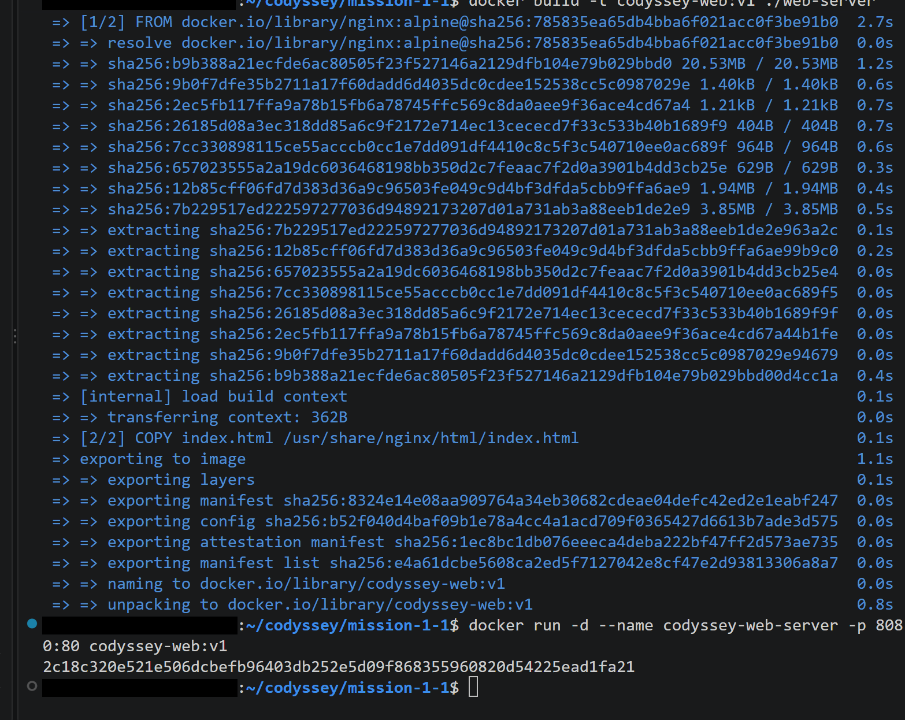
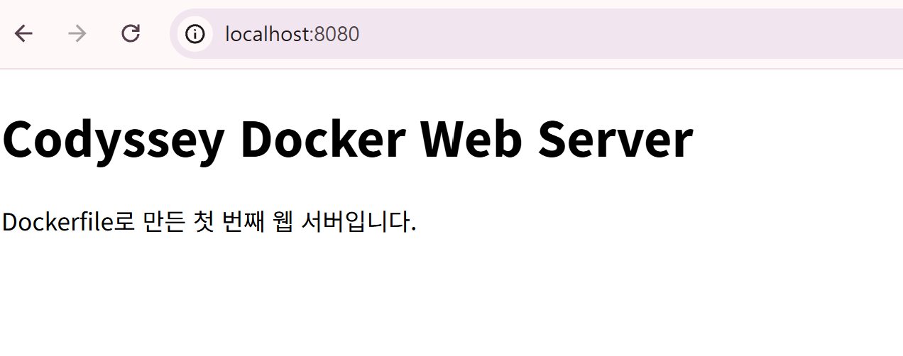

`nginx:alpine`은 변경 가능한 태그입니다. 정확한 환경 재현이 필요하면 실습 당시 `docker image inspect nginx:alpine`의 이미지 ID·RepoDigests를 추가 기록합니다.

### Dockerfile 직접 작성 추가 실습

별도 [Dockerfile](dockerfile-manual-practice/Dockerfile)은 다음 내용이며 기존 웹 서버 파일을 보존한 실습입니다.

```dockerfile
FROM nginx:alpine
COPY index.html /usr/share/nginx/html/index.html
EXPOSE 80
```

Nginx 베이스는 정적 파일을 제공하는 웹 서버를 포함하며 Alpine 기반으로 구성되어 있습니다. 커스텀 포인트는 기본 페이지를 미션용 HTML로 교체하는 것이고, `EXPOSE 80`은 서비스 포트를 명시합니다. 실제 호스트 연결은 `-p`로 설정합니다.

```bash
# history 발췌: 원본 번호 150~156, 출력 없음
cat web-server/Dockerfile
mkdir -p dockerfile-manual-practice
nano dockerfile-manual-practice/Dockerfile
cp web-server/index.html dockerfile-manual-practice/index.html
docker build -t codyssey-web:manual-check ./dockerfile-manual-practice
docker run -d --name codyssey-web-manual-check -p 127.0.0.1:8081:80 codyssey-web:manual-check
curl -i http://localhost:8081
```

nano에서 직접 작성한 내용, 빌드 `FINISHED`, 컨테이너 ID 반환 및 `curl -i http://localhost:8081`의 `HTTP/1.1 200 OK`와 미션 HTML 본문을 확인했습니다. 직접 작성·빌드·실행 및 응답 검증을 완료했습니다. 재현할 때에는 기존 컨테이너 이름·포트 사용 여부를 먼저 확인합니다.


## 5. Bind Mount 변경 전후 확인

`bind-mount/shared.txt` 파일의 존재는 확인했습니다. 아래 예시는 기존 파일을 덮어쓰지 않도록 별도의 `replay.txt`를 사용합니다. 해당 파일이 이미 있으면 다른 이름을 정합니다.

```bash
cd /path/to/mission-1-1
printf 'before\n' > bind-mount/replay.txt
docker run -d --name codyssey-bind --mount type=bind,source="$(pwd)/bind-mount",target=/data,readonly ubuntu:24.04 sleep infinity
cat bind-mount/replay.txt
docker exec codyssey-bind cat /data/replay.txt
printf 'after\n' > bind-mount/replay.txt
cat bind-mount/replay.txt
docker exec codyssey-bind cat /data/replay.txt
```

호스트의 파일 변경이 컨테이너에도 반영되는지 변경 전후의 실제 출력을 비교합니다.

**증빙:** 실제 화면은 `shared.txt`를 `/shared`에 읽기 전용으로 연결하여 변경 전후를 읽습니다. 위 `replay.txt`·`/data` 재현 예시와 경로가 다르며, 실제 화면에서는 변경 전후 각각 새 임시 컨테이너를 실행합니다.

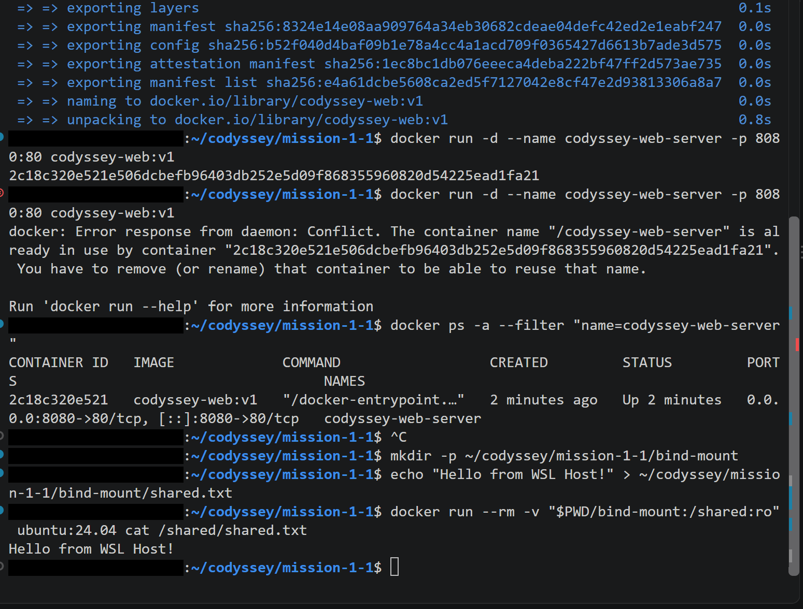

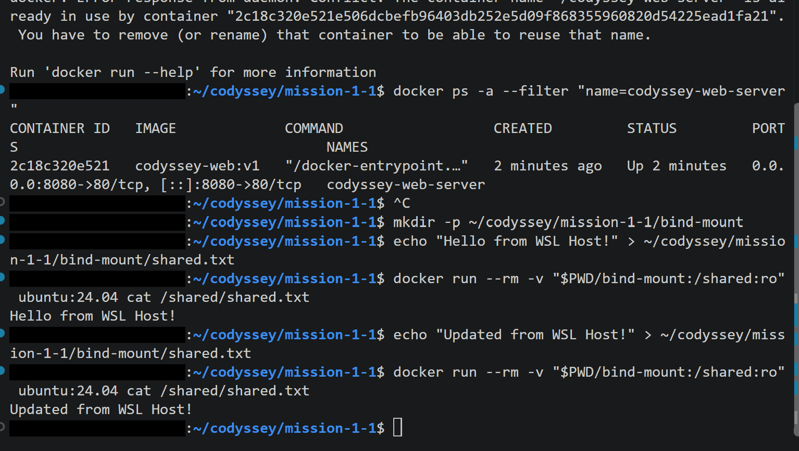

## 6. Named Volume 데이터 영속성

```bash
docker volume create codyssey-data
docker run --name codyssey-volume-write --mount type=volume,source=codyssey-data,target=/data ubuntu:24.04 bash -c 'printf "persistent data\n" > /data/message.txt; cat /data/message.txt'
docker rm codyssey-volume-write
docker run --rm --name codyssey-volume-read --mount type=volume,source=codyssey-data,target=/data ubuntu:24.04 cat /data/message.txt
docker volume inspect codyssey-data
```

첫 컨테이너를 삭제한 뒤 새 컨테이너에서 같은 데이터가 읽히는지 확인합니다. 컨테이너가 없어져도 Named Volume은 별도로 남습니다. 증거를 확보하기 전에 `docker volume rm codyssey-data`를 실행하지 않습니다. 위 데이터 문자열은 명령어의 입력값이며 실제 관찰한 결과가 아닙니다.

**증빙 위치:** 쓰기 결과, 첫 컨테이너 삭제, 새 컨테이너 읽기 결과와 볼륨 정보.

실제 화면은 `--rm`으로 쓰기 컨테이너를 자동 삭제한 뒤 새 컨테이너에서 같은 볼륨을 읽는 기록입니다. 입력 문자열은 위 재현 예시와 다릅니다.

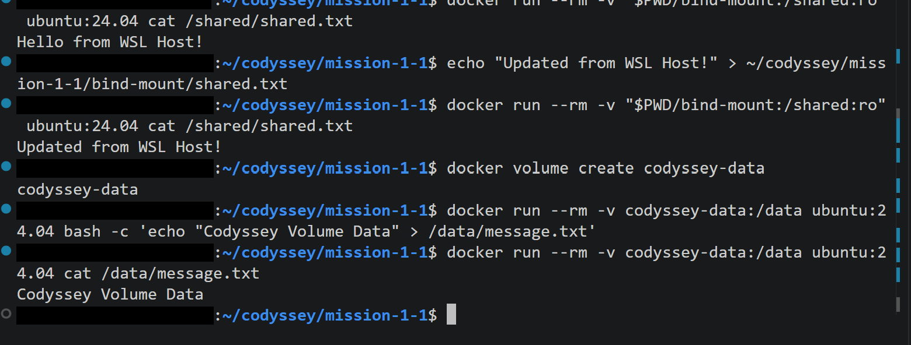

### 삭제 전후 비교를 위한 추가 명령 기록

```bash
# history 발췌: 원본 번호 145~148, 출력 없음
docker volume create codyssey-final-volume-check
docker run --name codyssey-final-volume-before -v codyssey-final-volume-check:/data ubuntu:24.04 bash -c 'echo "Codyssey volume persistence verified" > /data/check.txt; cat /data/check.txt'
docker rm codyssey-final-volume-before
docker run --rm --name codyssey-final-volume-after -v codyssey-final-volume-check:/data ubuntu:24.04 cat /data/check.txt
```

새 이미지에서 삭제 전 읽기, 컨테이너 삭제 결과, 새 컨테이너의 읽기를 확인했습니다. 두 읽기에서 `Codyssey volume persistence verified`가 동일하게 출력되어 컨테이너 삭제 후 Named Volume의 데이터 유지를 검증했습니다. 위 컨테이너 삭제 명령은 이름을 정확히 확인한 별도 실습 자원에만 적용하며 기존 컨테이너·볼륨에는 적용하지 않습니다.

/named-volume-before.png>)

/named-volume-container-removed.png>)

/named-volume-after.png>)

## 7. 실제 발생한 문제 해결 기록

다음 두 사례는 사용자가 제공한 실제 수행 기록을 정리한 것입니다. 제공된 오류 문구와 확인 결과만 기록했으며, 아래에 관련 스크린샷을 연결했습니다. 스크린샷에 없는 해결 단계는 사용자 제공 기록입니다.

### 사례 1: Docker 소켓 권한 오류

- 증상: `docker info` 실행 시 `permission denied while trying to connect to the docker API at unix:///var/run/docker.sock` 오류가 발생했습니다.
- 원인 확인: `id` 출력에 `docker` 그룹이 없었고, `ls -l /var/run/docker.sock` 결과에서 `srw-rw---- 1 root docker`를 확인했습니다. 사용자가 소켓에 접근할 수 있는 `docker` 그룹에 속하지 않은 상태였습니다.
- 해결: WSL Ubuntu에서 다음 명령어로 현재 사용자를 `docker` 그룹에 추가했습니다.

```bash
sudo /usr/sbin/usermod -aG docker "$USER"
```

이후 Windows PowerShell에서 WSL을 종료하고 Ubuntu에 재접속했습니다.

```powershell
wsl --shutdown
wsl -d Ubuntu
```

- 재검증: 재접속 후 `id` 출력에 `1001(docker)` 그룹이 추가되었고, `docker info`의 Server 정보가 정상 출력되었습니다. `docker run hello-world`도 성공했습니다.
- 참고: `newgrp docker`는 명령어가 없어 사용하지 못했습니다.

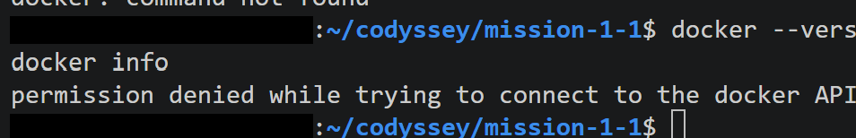

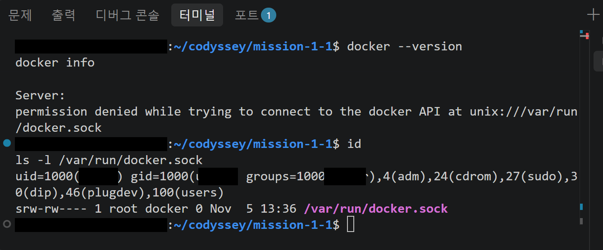

해결 후 서버 정보와 hello-world 성공 화면은 3절에 배치했습니다. 그룹 추가 명령어, WSL 재접속, 재접속 후 `id` 결과는 위 이미지에 포함되어 있지 않습니다.

### 사례 2: 동일한 컨테이너 이름 충돌

- 증상: 다음 명령어가 이미 성공한 뒤 같은 명령어를 다시 실행하여 이름 충돌 오류가 발생했습니다.

```bash
docker run -d --name codyssey-web-server -p 8080:80 codyssey-web:v1
```

제공된 오류 문구: `Conflict. The container name "/codyssey-web-server" is already in use`

- 확인: `docker ps -a --filter "name=codyssey-web-server"` 실행 결과에서 `STATUS`는 `Up 2 minutes`, `PORTS`는 `0.0.0.0:8080->80/tcp`로 확인했습니다.
- 해결: 기존 컨테이너가 실행 중이므로 삭제하거나 재생성하지 않고 그대로 사용했습니다.
- 재검증: Windows 브라우저에서 `localhost:8080`에 접속하여 `Codyssey Docker Web Server` 웹페이지가 표시되는 것을 확인했습니다.

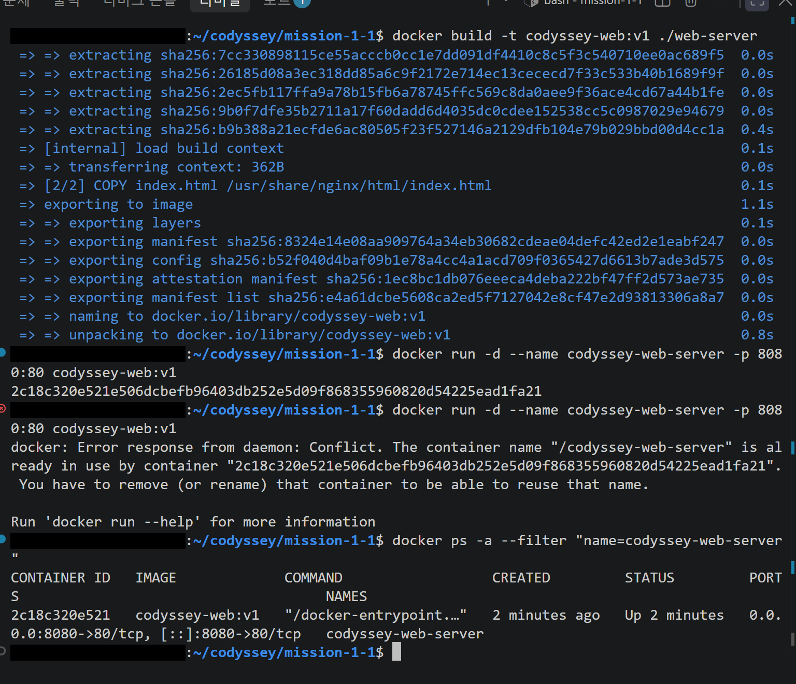

브라우저 접속 성공 화면은 4절에 배치했습니다.

## 8. Git과 GitHub 사용법

기본 브랜치는 사용자 제공 정보에 따라 `main`을 기준으로 설명합니다. 기존 저장소이므로 `git init`을 다시 실행하지 않습니다. 다음은 사용자가 직접 실행할 명령어입니다.

```bash
cd /path/to/mission-1-1
git status
git branch --show-current
git config --get user.name
git config --get user.email
git config --get init.defaultBranch
```

설정이 필요한 경우에만 아래 예시 값을 본인의 공개 가능한 정보로 바꿉니다. `init.defaultBranch`는 향후 생성할 저장소의 기본값이며 기존 브랜치를 변경하지 않습니다.

```bash
git config user.name "YOUR_NAME"
git config user.email "YOUR_PUBLIC_OR_NOREPLY_EMAIL"
git config --global init.defaultBranch main
```

스크린샷을 준비한 뒤 VS Code 소스 제어 화면에서 변경 파일을 검토하고, 사용자 터미널에서 제출합니다.

```bash
git diff
git status --short
git add .gitignore README.md web-server/ practice.txt permission-test/ bind-mount/
# evidence/를 실제로 생성하고 민감정보 점검을 마친 뒤에만 실행
git add evidence/
git diff --cached --stat
git diff --cached
git commit -m "docs: prepare Codyssey mission 1-1 submission"
# origin이 이미 있으면 추가하지 말고 연결 대상을 확인
git remote -v
# origin이 없을 때만 실제 URL로 교체하여 실행
git remote add origin https://github.com/YOUR_ACCOUNT/YOUR_REPOSITORY.git
git push -u origin main
```

GitHub 인증에는 비밀번호나 토큰을 저장소 URL·문서에 넣지 않습니다. VS Code의 GitHub 인증 흐름 등을 사용하고 GitHub 저장소에서 README와 증거가 표시되는지 확인합니다.

**제출 Repository URL:** [https://github.com/inyoung7-lab/ia-codyssey-allinone-test1-1](https://github.com/inyoung7-lab/ia-codyssey-allinone-test1-1)

**Git 실습 증빙**

첫 커밋 성공 화면에서 `main` 브랜치의 루트 커밋 `10e3f6a`와 파일 등록 결과를 확인할 수 있습니다.

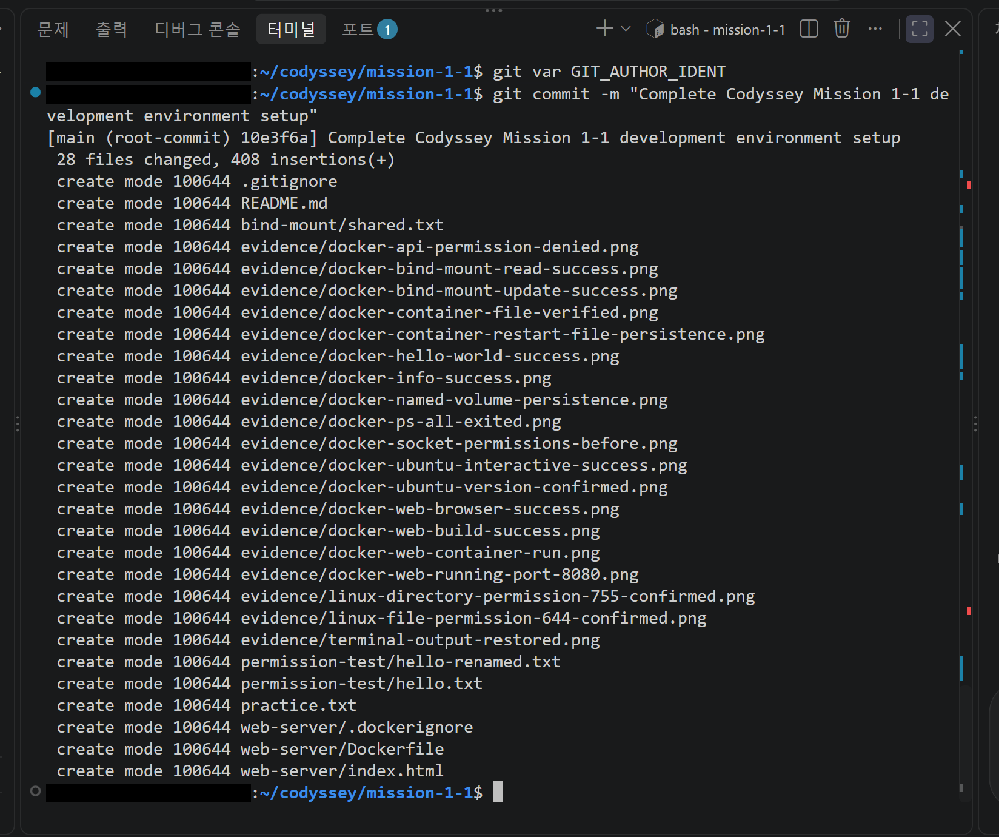

병합·업로드 화면에서 병합 커밋 `e4361d0`, `git push -u origin main`의 `main -> main` 성공 출력, `origin/main` 추적 설정 및 병합 이력을 확인할 수 있습니다. 이 화면은 당시 업로드의 증거이며, 이번에 추가한 이미지와 README 수정분의 업로드를 증명하지는 않습니다.

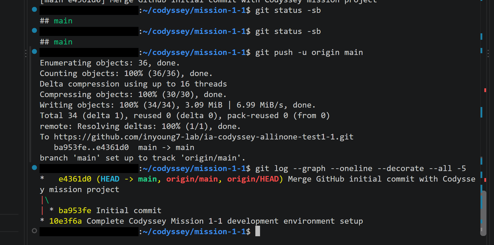

**추가 증빙 필요:** GitHub 브라우저에서 저장소 파일 목록과 README가 표시되는 화면은 아직 포함되어 있지 않습니다.

### 추가 Git 설정 및 개인정보 확인

기존 Git 설정 화면에서 사용자 이름, 기본 브랜치 `main`, 제출 저장소의 원격 URL 및 추적 설정을 확인했습니다. 새 `git-config-list-evidence.png`에는 `git config --list` 입력과 결과가 함께 보이며 `init.defaultbranch=main`, `branch.main.remote=origin`, `branch.main.merge=refs/heads/main`을 확인했습니다. 사용자 이름·이메일·원격 URL 값 일부는 회색 사각형으로 가려져 있어 숨겨진 값을 추정하지 않습니다. 원격 주소는 기존 `git-configuration-verified.png`와 제출 URL로 확인합니다. 새 계정 메뉴 화면에는 `(GitHub)`와 `로그아웃`이 보여 VS Code의 GitHub 로그인 상태를 확인했습니다. 계정명은 가려져 있으므로 특정 계정명 자체를 판독했다고 주장하지 않습니다. Git은 로컬 변경 이력을 관리하고, GitHub는 원격 저장소 공유·협업을 제공합니다.

기존 이미지에는 사용자명·호스트명·사용자 경로가 보입니다. Git push 화면에는 공개 제출 저장소의 GitHub 계정명도 포함됩니다. `vscode-github-login-confirmed.png`에는 이메일 값 일부가 보입니다. 전체 주소나 noreply 여부는 잘린 화면으로 확정하지 않습니다. 공개 저장소 주소는 결과 링크로 유지하되 불필요한 개인 식별정보는 마스킹 검토 대상입니다. 비밀번호·토큰·개인키·인증 코드는 공개하면 안 됩니다. 원본 이미지는 이번 정리에서 수정하지 않았습니다.


### 최종 추가 Git 증빙

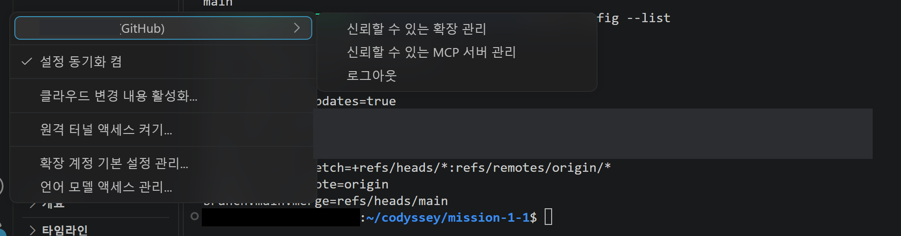

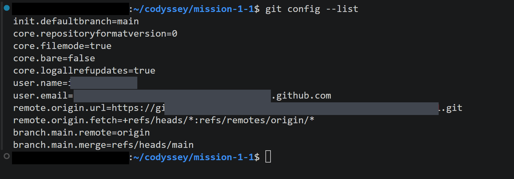

두 이미지는 기존 history·소스 제어 화면과 다른 추가 증거입니다. 공개용 입력 파일의 회색 마스킹을 그대로 유지해 복사했으며 픽셀이나 실행 결과를 변경하지 않았습니다. 프롬프트의 컴퓨터 호스트명과 로컬 사용자명이 남아 있습니다. 호스트명 공개는 사용자 허용 범위이며, 기존 증빙보다 마스킹 범위가 좁다는 점은 공개 전 확인 대상으로 남깁니다.

## 9. 실제 출력과 제출 전 확인

문서 작성 시 파일 조회로 확인한 결과:

```text
644 0 practice.txt
755 4096 permission-test
644 22 permission-test/hello.txt
644 22 permission-test/hello-renamed.txt
```

위 결과는 `stat -c '%a %s %n'` 출력이며 순서대로 권한·크기(바이트)·경로입니다. 디렉터리 크기는 환경에 따라 달라질 수 있습니다. Docker 실행 화면은 관련 실습 절의 증빙 이미지로 연결했습니다.

- [x] 실행 환경 및 Docker CLI·서버 버전 실제 출력 연결
- [x] CLI 위치·목록·내용 조회 실제 결과 연결
- [ ] CLI 생성·빈 파일·복사·이동·삭제 당시 결과 증빙 확인(history와 구분)
- [x] 파일 644·600·644 및 디렉터리 755·700·755 변경 증거 연결
- [x] hello-world 및 Ubuntu 대화형·재시작 증거 연결
- [x] Docker 이미지·컨테이너 목록·로그·리소스 출력 연결
- [ ] docker stop 직접 실행 결과·전후 기록 확인(이력과 종료 상태는 있음)
- [x] Dockerfile 직접 작성·빌드·실행·HTTP 200 증거 연결
- [x] 포트 매핑·주소창 포함 브라우저 증거 연결
- [x] Bind Mount 변경 전후 및 Named Volume 삭제 전후 데이터 유지 증거 연결
- [x] 트러블슈팅 2건 기록 및 관련 증거 연결(일부 단계는 사용자 보고)
- [x] PNG 47개를 각각 한 번씩 연결하고 상대경로 확인
- [x] Git 기본 브랜치·사용자 이름·원격·추적 설정 증거 연결
- [x] git config --list 결과 및 VS Code GitHub 로그인·저장소 연동 증거 연결
- [ ] 불필요한 개인 식별정보 마스킹·공개 전 검토
- [ ] 최종 커밋·업로드 후 GitHub에서 전체 문서·파일 접근 확인

### 공개 전 보안 검토

기존 PNG 45개는 검증된 공개용 자료이며, 개인정보가 확인된 31개에는 불투명 마스킹이 적용되어 있습니다. 새 이미지 2개는 제공된 회색 마스킹 상태 그대로 복사했습니다. 새 화면의 호스트명·로컬 사용자 프롬프트는 남아 있어 기존 정책과 차이가 있습니다. 계정명·이메일 값은 가려져 있으며 검사 화면에서 비밀번호·토큰·개인키·인증 코드는 식별하지 못했습니다. `.gitignore`는 이미지 내부 개인정보를 숨기지 않습니다. 이번 작업은 공개·업로드를 수행하지 않았습니다.

`.gitignore`는 아직 추적하지 않는 파일에 적용되며 이미 커밋된 비밀 정보를 제거하지 않습니다. `.env.example`과 `.env.sample`에는 실제 비밀값을 넣지 않습니다. 증거에는 주소창·실행 결과를 남기되 불필요한 개인정보를 가립니다.

## 개인정보 이력 정리 안내

공개 전 개인정보 보호를 위해 과거 이미지 원본을 Git 이력에서 제거하고 마스킹된 증빙을 다시 등록했습니다. 기존 Git 스크린샷의 커밋 ID는 **이력 정리 전 실제 수행 기록**이며 현재 이력의 ID와 다릅니다. 화면의 명령·결과·커밋 ID는 바꾸지 않았습니다. 공개용 이미지에는 개인정보 영역에 불투명 마스킹을 적용했으며 원본은 공개 저장소 밖에 비공개로 보관합니다.

아래 `/path/to/mission-1-1`은 예시 경로입니다. 저장소를 clone한 실제 경로로 바꾸어 실행합니다.

| 정리 전 커밋 | 정리 후 대응 커밋 |
| --- | --- |
| `10e3f6a` | `b3eab07` |
| `25f4e69` | `9ea079a` |
| `ba953fe` | `b7ac455` |
| `e4361d0` | `69d09a4` |

## 공식 필수 요구사항 최종 대조

기준은 [공식 원문](mission-requirements.md)의 2·4·7절입니다. 3절은 기술 설명, 5절은 선택 과제로 분리하며 8절의 예시는 필수 조건으로 추가하지 않습니다. 아래 상태는 현재 로컬 문서·파일·증빙 기준이며 새 자료의 원격 업로드 완료를 뜻하지 않습니다.

| 공식 필수 항목 | 판정 | 근거 및 제한 |
| --- | --- | --- |
| 제출 URL·프로젝트 개요·결과 링크 | 완료 | 제출 URL, 프로젝트 목적, 실습별 이미지·문서 링크 |
| 실행 환경 OS·Shell·터미널·Docker·Git | 완료 | 환경 이미지의 실제 버전과 VS Code 통합 터미널 화면 |
| 체크리스트·재현 절차·기술 설명 | 완료 | 경로 대체 안내, 명령 코드블록, 권한·포트·볼륨·Git 역할 설명 |
| CLI 생성·빈 파일·복사·이동·삭제 | 부분 충족 | 명령 이력과 일부 실제 결과 있음. 모든 당시 결과가 직접 보이지는 않음 |
| 파일·디렉터리 권한 변경 전후 | 완료 | 파일 644·600·644 및 디렉터리 755·700·755 실제 결과 |
| Docker 버전·정상 서버 점검 | 완료 | CLI·서버 버전 실제 출력 및 기존 Docker 정보 |
| 이미지 다운로드·목록·컨테이너 실행·목록·로그·리소스 | 완료 | 기존 pull·run, 새 images·ps·logs·stats 출력 |
| 컨테이너 직접 중지 결과 | 부분 충족 | stop 입력 이력과 종료 상태 있음. 직접 반환 결과는 미확보 |
| hello-world·Ubuntu 내부 명령·종료/유지 차이 | 완료 | 실제 실행·재진입 화면 및 주 프로세스와 exec 설명 |
| Dockerfile 직접 작성·커스텀 목적·빌드·실행 | 완료 | nano 작성 화면, 소스 파일, 빌드 완료·실행·HTTP 200 |
| 포트 매핑·주소창 포함 브라우저 | 완료 | 실행 명령과 localhost:8080 브라우저 응답 |
| Bind Mount 변경 전후 | 완료 | 호스트 변경 전후 컨테이너 읽기 결과 |
| Named Volume 삭제 전후 데이터 유지 | 완료 | 생성 이력, 연결·삭제 전 읽기·삭제·새 컨테이너 읽기 |
| Git 사용자·기본 브랜치·config --list | 완료 | 기존 사용자·원격 설정과 새 전체 목록 화면. 비공개 값은 마스킹 |
| VS Code GitHub 로그인·저장소 연동 | 완료 | 새 GitHub 계정 메뉴·로그아웃 화면 + 기존 소스 제어·원격·추적 설정 |
| 트러블슈팅 2건 | 완료 | 문제·원인 확인·해결/대안 기록과 관련 증거. 일부 단계는 사용자 제공 기록 |
| 보안·개인정보 보호 | 부분 충족 | 인증 비밀정보는 식별되지 않음. 새 화면의 사용자·호스트 표시와 기존 마스킹 정책 차이 검토 필요 |

현재 검토에서 필수 실습의 확정적인 미수행을 뜻하는 ‘미충족’ 항목은 없습니다. 부분 충족은 문서만으로 성공을 확정할 수 없는 증거 범위입니다. 보너스 Compose·환경 변수·SSH는 필수 미완료로 계산하지 않습니다.
