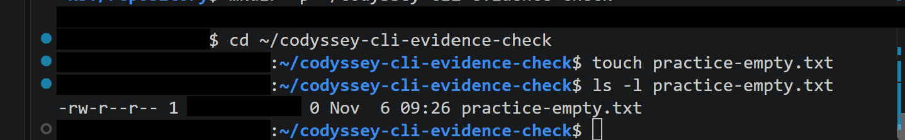
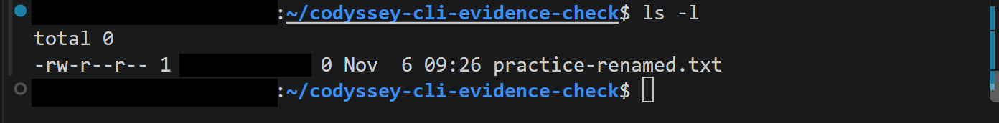
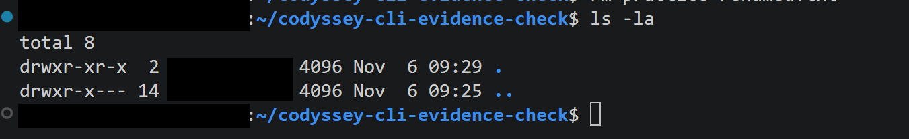
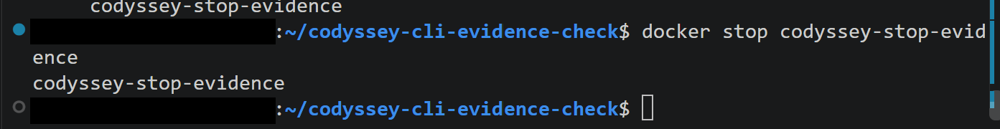

# Codyssey 개발 입문 미션 1-1

내 컴퓨터에 개발자용 작업실을 구성하고 Linux CLI, 파일 권한, Docker, Git을 실습하는 프로젝트입니다. Dockerfile 기반 정적 웹 서버를 만들고 포트 매핑, Bind Mount, Named Volume의 동작을 확인하는 것을 목표로 합니다.

## 실행 환경 및 검증 기준

- 사용자 제공 환경: Windows 11 + WSL2 Ubuntu + Docker Desktop, VS Code + WSL 확장
- 재현 경로: clone한 프로젝트 루트(`PROJECT_DIR`). `/path/to/mission-1-1`은 개인 경로가 아닌 예시입니다.
- 기본 브랜치: `main` (사용자 제공 정보)
- Docker Desktop에서 WSL2 엔진과 해당 Ubuntu 배포판의 WSL 통합이 활성화되어 있어야 합니다.
- 명령어는 **재현 안내**, **셸 history 발췌**, **파일 조회 결과**, **2026-11-07 추가 검증 로그**로 구분합니다. 재현 안내는 실행 증거가 아니며, history에는 성공 여부를 판단할 출력이 없습니다. 이번 문서 정리에서 Docker 실행·중지·삭제 및 Git add·commit·push는 수행하지 않았습니다.
- 실제 출력·파일로 확인한 사실과 사용자 보고·명령 이력을 구분합니다. 각 이미지의 확인 범위를 캡션에 표시합니다. 기존 공개용 PNG의 마스킹은 유지하며, 이번 README·새 로그의 최종 GitHub 반영 확인은 별도입니다.

### 공식 기준 및 추가 실습 자료

공식 기준은 [사용자 제공 미션 원문](mission-requirements.md)의 2·4·7절이며, 5절 보너스는 필수와 구분합니다.

- [추가 명령어 이력](evidence/cli-docker-command-history.txt): history 134~160번. 명령 입력 기록이며 실행 출력은 포함하지 않습니다.
- [CLI 실습 파일](cli-evidence-practice/practice-empty.txt): 현재 28바이트입니다. 이름과 달리 현재 빈 파일은 아니며, 과거 `touch` 수행 여부는 별도 로그로 확인해야 합니다.
- [mv·rm 추가 검증 원본 로그](evidence/linux-cli-mv-rm-execution-log.txt): 2026-11-07 10:25:38 KST에 수행한 별도 검증입니다. 명령·출력·각 종료 코드를 포함합니다.
- [직접 작성 실습 Dockerfile](dockerfile-manual-practice/Dockerfile), [정적 HTML](dockerfile-manual-practice/index.html)

환경 증빙의 실제 출력에서 WSL 호스트 Ubuntu 26.04.1 LTS, Bash(`/bin/bash`), Docker CLI·서버 29.9.2, Git 2.53.0을 확인했습니다. 기존 Ubuntu 24.04 컨테이너와 호스트 OS 버전은 서로 다른 환경입니다. 터미널은 VS Code 통합 터미널 사용 화면이 있습니다.


### 개인 경로를 바꾸어 재현하는 방법

`/path/to/mission-1-1`은 예시 경로입니다. 아래에서 clone한 실제 위치를 `PROJECT_DIR`에 저장하고, 후속 재현 명령은 이 프로젝트 루트를 사용합니다. 새 터미널을 열면 실제 clone 위치로 이동한 뒤 `export PROJECT_DIR="$PWD"`를 다시 실행합니다. Docker Desktop의 해당 WSL 배포판 통합을 켜고 WSL 터미널에서 실행합니다. 같은 이름의 컨테이너·파일이나 점유된 포트가 있으면 새 이름·빈 포트를 사용하며, 기존 자원을 임의 삭제하지 않습니다.

```bash
# 재현 안내: 원하는 상위 폴더에서 저장소가 아직 없을 때
git clone https://github.com/inyoung7-lab/ia-codyssey-allinone-test1-1.git
cd ia-codyssey-allinone-test1-1
export PROJECT_DIR="$PWD"
pwd
```

후속 상대경로는 이 프로젝트 루트를 기준으로 합니다. 아래 코드는 **재현 안내**이며 이번 문서 정리에서 실행한 결과가 아닙니다.

재현 순서는 환경 준비·clone → 1절 CLI → 2절 권한 → 3절 Docker/Ubuntu → 4절 웹 서버 → 5절 Bind Mount → 6절 Named Volume → 8절 Git 상태 확인입니다. Ubuntu 컨테이너 내부 명령과 WSL 호스트 명령은 구분합니다. 7절은 과거 장애 기록이며 재현을 위해 오류를 일부러 만들 필요가 없습니다. 8절의 설정·커밋·Push는 필요한 경우에만 사용자가 검토 후 수행합니다.

CLI 재현은 새 `cli-replay/`만 사용합니다. 이름이 이미 있으면 해당 블록을 중단하고 새 폴더명으로 CLI·권한 절의 경로를 함께 바꿉니다. Docker도 기존 자원을 삭제하여 이름을 확보하지 말고, 충돌 시 새 이름·빈 포트를 정해 관련 후속 명령에 일관되게 반영합니다. Named Volume 재현은 기존 실습 데이터와 구분한 새 볼륨명을 사용하고, 컨테이너 삭제는 해당 블록에서 새로 생성한 쓰기 컨테이너에만 적용합니다. Bind Mount의 `replay.txt`가 이미 있으면 새 파일명을 사용합니다.

이 순서와 상대경로는 문서·파일 대조로 점검했습니다. 독립된 Windows/WSL/Docker 환경에서 전체 절차를 재실행하여 검증한 것은 아닙니다.

## 프로젝트 구성

```text
mission-1-1/
├── .gitignore
├── README.md
├── mission-requirements.md
├── evidence/                 # PNG 51개 및 TXT 증빙
├── cli-evidence-practice/    # 기존 CLI 실습 파일
├── dockerfile-manual-practice/
│   ├── Dockerfile
│   └── index.html
├── practice.txt
├── permission-test/
│   ├── hello.txt
│   └── hello-renamed.txt
├── bind-mount/
│   └── shared.txt
└── web-server/
    ├── Dockerfile
    ├── .dockerignore
    └── index.html
```

`evidence/`의 PNG 증빙은 아래 관련 실습 절에서 각각 한 번씩 참조합니다. 최종 개수는 하단 체크리스트에 기록합니다. 이미지를 직접 확인하여 배치했으며, 재현 안내 명령어와 당시 실행 화면의 이름·입력값이 다른 경우 캡션으로 구분합니다.

## 1. Linux 명령어와 경로

사용자는 기본 CLI 실습을 수행했습니다. 아래에서 실제 결과가 있는 조회 화면과 명령 이력만 있는 생성·복사·이동 기록을 구분합니다.

다음 명령어는 기존 파일과 구분한 새 `cli-replay/`에서 수행하는 재현 예시입니다. 서브셸의 `set -e`는 폴더 생성 등 명령이 실패하면 뒤의 파일 조작을 중단합니다. `hello.txt`와 폴더는 다음 권한 실습에 사용하므로 남깁니다.

```bash
(
set -e
cd "$PROJECT_DIR"
pwd
ls
ls -la
mkdir cli-replay
cd cli-replay
touch practice.txt
echo 'Hello Codyssey' > hello.txt
cat hello.txt
cp hello.txt hello-copy.txt
mv hello-copy.txt hello-renamed.txt
ls -l hello-renamed.txt
test ! -e hello-copy.txt
rm -- hello-renamed.txt
test ! -e hello-renamed.txt
cd ..
)
```

- 절대경로: `/path/to/mission-1-1`처럼 `/`에서 시작합니다.
- 상대경로: 현재 위치를 기준으로 하는 `cli-replay/hello.txt` 등입니다.
- `.`은 현재 디렉터리, `..`은 상위 디렉터리입니다.

**증빙:** VS Code 터미널의 출력 확인 화면입니다. CLI 전체 명령어 수행 이력을 증명하는 화면은 아닙니다.


### 추가 CLI 수행 기록의 확인 범위

`cli-evidence-practice/`에서의 명령 이력과 새 조회 결과를 연결했습니다. 새 화면은 `cd`, `pwd`, `ls -la`, `cat`의 입력과 출력, 실제 파일 내용을 보여줍니다. 생성·빈 파일·복사·이동의 당시 결과는 history만으로 확정하지 않습니다. 삭제 확인 질문 화면도 실제 삭제 완료 응답은 포함하지 않습니다.

```bash
# history 발췌: 원본 번호 134~135, 출력 없음
rm -i practice-renamed.txt
ls -l
```

삭제 확인 질문에 대한 응답과 삭제 후 목록은 이력에 없습니다. 파일 존재만으로 복사·이동·삭제 성공을 확정하지 않습니다.


### 별도 CLI 추가 검증

아래 화면은 기존 `cli-evidence-practice/`와 다른 `codyssey-cli-evidence-check/`의 추가 검증입니다. 기존 이력과 하나의 연속 실행으로 묶지 않습니다.



`touch practice-empty.txt` 입력과 이어진 `ls -l practice-empty.txt`의 크기 `0`을 확인했습니다. 빈 파일 생성·확인 증거로 연결합니다.



이 화면의 입력은 `ls -l`이며 결과에 `practice-renamed.txt`가 존재합니다. 이미지 자체에는 `mv` 입력이나 변경 전 이름이 없으므로, 파일 이름 변경 명령의 직접 성공 증거라고 단정하지 않습니다.



`ls -la` 결과에는 `.`과 `..`만 있습니다. 해당 시점의 파일 부재를 확인하지만 이미지 자체에 `rm` 입력·삭제 대상·확인 응답은 없습니다. 위 이름 존재 화면과 함께 참고할 수 있으나 촬영 사이의 모든 동작을 추정하지 않습니다.

### 2026-11-07 mv·rm 직접 실행 추가 검증

**수행 시각: 2026-11-07 10:25:38 KST**(로그 UTC: `2026-11-07T01:25:38Z`). 기존 실습·PNG와 별도로 새 파일 `source.txt`를 생성하여 수행했습니다. 위 결과 이미지를 이 로그와 하나의 연속 실행으로 해석하지 않습니다.

[명령·실제 출력·종료 코드를 포함한 원본 로그](evidence/linux-cli-mv-rm-execution-log.txt)를 바이트 변경 없이 복사했습니다. 전체 12개 명령의 종료 코드가 모두 `0`입니다. 아래는 원본에서 그대로 발췌한 명령과 출력이며, 출력 없는 `test`는 `[exit=0]`으로 조건의 성공을 확인합니다.

```text
$ mv -n -- source.txt renamed.txt
[exit=0] 성공

$ test \! -e source.txt
[exit=0] 성공

$ test -f renamed.txt
[exit=0] 성공

$ ls -1 -- renamed.txt
renamed.txt
[exit=0] 성공

$ cat -- renamed.txt
CLI rename and removal verification
[exit=0] 성공

$ rm -- renamed.txt
[exit=0] 성공

$ test \! -e renamed.txt
[exit=0] 성공
```

`mv -n` 이후 원래 이름의 부재와 새 이름의 일반 파일 존재, 목록·내용을 확인했습니다. `rm` 이후에는 새 이름의 부재를 확인했습니다. 원본 로그 마지막 단계는 두 이름 모두 존재하지 않음을 확인하고 `최종 판정: 모든 단계 성공`을 기록합니다. 기존 PNG의 명령 누락은 이미지 자체의 한계로 유지하고, 직접 입력·결과 근거는 이 별도 TXT로 보완합니다. 공개 로그에는 작업 위치·호스트명·계정 식별정보를 기록하지 않았습니다.

원본/제출본 SHA-256: `c8b3bf831748078e82753dcd1c4d549dcf58288424557cdd9427d779d5af9d0b`.

## 2. 파일·디렉터리 권한

`r`은 읽기, `w`는 쓰기, `x`는 실행 권한입니다. 디렉터리에서는 `r`이 항목 목록 읽기, `w`가 항목 생성·삭제, `x`가 내부 접근을 뜻합니다. 항목 생성·삭제에는 일반적으로 디렉터리의 `w`와 `x`가 함께 필요합니다.

권한 숫자는 소유자·그룹·기타 사용자 순서이고, `r=4`, `w=2`, `x=1`을 더합니다.

| 권한 | 의미 |
| --- | --- |
| `644` | 소유자 읽기·쓰기, 그룹과 기타 사용자 읽기 |
| `755` | 소유자 읽기·쓰기·실행, 그룹과 기타 사용자 읽기·실행 |

사용자는 파일 `644 → 755 → 644`, 디렉터리 `755 → 644 → 755` 변경을 수행했다고 보고했습니다. 문서 작성 시 `practice.txt`와 두 hello 파일은 `644`, `permission-test/`는 `755`로 확인했습니다. 중간 변경 과정은 미검증입니다.

```bash
# 앞 절에서 만든 재현용 파일과 폴더 사용
chmod 644 cli-replay/hello.txt
ls -l cli-replay/hello.txt
chmod 755 cli-replay/hello.txt
ls -l cli-replay/hello.txt
chmod 644 cli-replay/hello.txt
chmod 644 cli-replay
ls -ld cli-replay
# 디렉터리의 x 권한을 없애면 내부 파일 접근이 제한됩니다.
chmod 755 cli-replay
ls -ld cli-replay
```

**증빙:** 파일의 최종 `644`와 디렉터리의 최종 `755` 상태입니다. 권한 변경 중간 과정과 접근 제한 결과는 이 두 이미지로 확인할 수 없습니다.


CLI 증거는 역할을 나누어 읽습니다. `linux-cli-command-history.png`는 생성·복사·이동·삭제 명령 입력, `linux-cli-execution-results.png`는 위치·목록·내용의 실제 결과입니다. `file-permission-644-list.png`는 남아 있는 파일 목록이고 `cli-remove-confirmation-prompt.png`는 삭제 확인 질문입니다. 이 자료만으로 복사 직후 동일성·이름 변경 직후 목록·삭제 응답을 새로 만들어 설명하지 않습니다.

### 추가 파일·디렉터리 권한 실습

```bash
# history 발췌: 원본 번호 136~144, 출력 없음
stat -c '%a %A %n' practice-empty.txt
chmod 600 practice-empty.txt
stat -c '%a %A %n' practice-empty.txt
chmod 644 practice-empty.txt
stat -c '%a %A %n' practice-empty.txt
stat -c '%a %A %n' .
chmod 700 .
stat -c '%a %A %n' .
chmod 755 . && stat -c '%a %A %n' .
```

사용자 보고와 파일 배치를 기준으로 작업 대상은 `cli-evidence-practice/`로 연결됩니다. history 자체에는 진입 명령과 조회 출력이 없습니다. `600`은 소유자 읽기·쓰기만, `700`은 소유자 읽기·쓰기·실행만 허용합니다.

이번 문서 정리에서 `stat -c '%a %A %s %n'`으로 읽기 전용 조회한 결과:

```text
755 drwxr-xr-x 4096 cli-evidence-practice
644 -rw-r--r-- 28 cli-evidence-practice/practice-empty.txt
```

파일의 `644→600→644` 상태를 기존 이미지와 아래 실제 출력으로 확인했습니다. 별도 `permission-demo` 디렉터리의 `755→700→755`는 새 화면에 각 명령과 결과가 함께 있어 검증을 완료했습니다. 기존 `directory-permission-755-stat.png`는 실습 폴더 자체의 755 상태이며 새 디렉터리와 대상을 구분합니다.


## 3. Docker 준비 및 기본 컨테이너

Windows에서 Docker Desktop을 실행한 뒤 VS Code의 WSL Ubuntu 터미널에서 확인합니다.

```bash
docker --version
docker version
docker info
docker run --name codyssey-hello hello-world
docker ps -a
docker logs codyssey-hello
```

`docker --version`은 CLI 버전, `docker version`과 `docker info`는 서버 연결 상태도 확인합니다. 관련 실제 실행 화면은 이 절의 증빙 이미지에서 확인합니다. 환경 절의 새 화면에서 Docker CLI·서버 버전을 확인했습니다.

Ubuntu 대화형 컨테이너:

```bash
docker run -it --name codyssey-ubuntu ubuntu:24.04 bash
# 아래는 컨테이너 안에서 실행
cat /etc/os-release
pwd
ls -la
echo 'Hello from Ubuntu container'
exit
# 아래는 WSL 호스트에서 실행
docker ps -a
```

기본 이미지·컨테이너 운영 명령어:

```bash
docker images
docker ps
docker ps -a
docker inspect codyssey-ubuntu
docker start -ai codyssey-ubuntu
# 컨테이너 안에서 exit 후, 더 이상 필요 없을 때만 삭제
docker rm codyssey-ubuntu
```

정지에는 `docker stop <컨테이너이름>`, 불필요한 이미지 삭제에는 `docker rmi <이미지이름:태그>`를 사용합니다. 컨테이너 삭제는 컨테이너 내부 데이터를 잃을 수 있으므로 실습 증거를 먼저 보관합니다.

**증빙 위치:** Docker CLI·서버 버전, hello-world 실제 출력, Ubuntu 내부 명령어와 종료 후 상태.

아래는 실제 실행 화면입니다. hello-world는 재현 예시의 고정 이름 없이 실행된 기록입니다. 재시작 후 파일 확인은 같은 컨테이너의 파일 유지 증거이며, Named Volume 증거와 구분합니다. Docker 정보 이미지는 서버 정보의 하단 부분으로, CLI·서버 버전 전체를 보여주지는 않습니다.


### 추가 Docker 운영 실습 및 종료·유지 설명

새 증빙에서 이미지 목록, 컨테이너 목록, Nginx 로그와 리소스 사용량 출력을 확인했습니다. 목록에는 `codyssey-stop-test`가 `Exited (137)`로 표시됩니다. `docker stop` 입력은 이력에 있으나 중지 명령의 반환 출력·전후 비교는 별도 확보되지 않아 직접 중지 성공을 단정하지 않습니다. 로그의 `/` 요청은 200, `/favicon.ico`는 404입니다. 아이콘 누락과 본문 제공 성공을 구분합니다.

Ubuntu에서 Bash가 주 프로세스인 경우 `exit`로 Bash를 끝내면 컨테이너도 정지합니다. 기존 재시작 화면의 `docker start -ai`는 같은 컨테이너를 다시 시작하여 연결한 것입니다. `docker exec`는 실행 중인 컨테이너에 추가 프로세스를 실행하므로 그 명령이 끝나도 주 프로세스가 살아 있으면 컨테이너는 유지됩니다. 기존 파일 유지 증거와 Named Volume의 컨테이너 삭제 후 데이터 유지는 구분합니다.


중지 증거는 기존 `docker-operations-command-history.png`의 `docker stop codyssey-stop-test` 입력과 `docker-images-containers-results.png`의 종료 상태를 함께 참조합니다. 종료 상태만으로 종료 원인을 확정하지 않습니다. 공식 요구사항은 중지 명령·결과 기록이며 특정 전후 캡처 형식을 별도로 지정하지 않습니다.

### 별도 테스트 컨테이너 중지 추가 검증



위 이미지에서 직접 읽은 명령과 반환 출력입니다. 이번 문서 정리에서 다시 실행하지 않았습니다.

```text
$ docker stop codyssey-stop-evidence
codyssey-stop-evidence
```

별도 컨테이너 `codyssey-stop-evidence`에 대한 `docker stop` 입력과 같은 컨테이너 이름의 반환 출력을 확인했습니다. 기존 `codyssey-stop-test`의 history·종료 상태와는 다른 추가 검증이며, 이전 화면의 누락된 반환 출력으로 위장하지 않습니다. 공식 요구사항의 중지 명령·출력 기록을 이 화면으로 보완합니다. 이 이미지에 중지 전후 `docker ps` 목록까지 표시되어 있다고 주장하지 않습니다.

## 4. Dockerfile 기반 Nginx 웹 서버와 포트 매핑

확인된 `web-server/Dockerfile`의 주요 설정입니다.

```dockerfile
FROM nginx:alpine
COPY index.html /usr/share/nginx/html/index.html
EXPOSE 80
```

HTML에는 `Codyssey Docker Web Server` 제목과 `Dockerfile로 만든 첫 번째 웹 서버입니다.` 설명이 있습니다. `.dockerignore`는 HTML만 빌드 컨텍스트에 포함하도록 설정되어 있습니다.

```bash
cd "$PROJECT_DIR"
docker build -t codyssey-web:1.0 ./web-server
docker run -d --name codyssey-web -p 127.0.0.1:8080:80 codyssey-web:1.0
docker ps
docker port codyssey-web
docker logs codyssey-web
curl -i http://localhost:8080
```

Windows 브라우저에서 `http://localhost:8080`에 접속합니다. `8080`은 호스트 포트, `80`은 컨테이너 Nginx 포트입니다. `EXPOSE 80`만으로 호스트에 포트가 공개되지는 않으며 `-p`가 연결을 만듭니다. 브라우저 주소창과 페이지 제목·설명이 함께 보이도록 촬영합니다.

**증빙 위치:** 빌드 성공 로그, 컨테이너 상태·포트, HTTP 응답, 주소창이 포함된 웹페이지.

실제 화면은 `codyssey-web:v1` 이미지와 `codyssey-web-server` 컨테이너를 사용합니다. 위 재현 예시의 `codyssey-web:1.0`, `codyssey-web`, 로컬 주소 바인딩과 이름·옵션이 다릅니다.


`nginx:alpine`은 변경 가능한 태그입니다. 정확한 환경 재현이 필요하면 실습 당시 `docker image inspect nginx:alpine`의 이미지 ID·RepoDigests를 추가 기록합니다.

### Dockerfile 직접 작성 추가 실습

별도 [Dockerfile](dockerfile-manual-practice/Dockerfile)은 다음 내용이며 기존 웹 서버 파일을 보존한 실습입니다.

```dockerfile
FROM nginx:alpine
COPY index.html /usr/share/nginx/html/index.html
EXPOSE 80
```

Nginx 베이스는 정적 파일을 제공하는 웹 서버를 포함하며 Alpine 기반으로 구성되어 있습니다. 커스텀 포인트는 기본 페이지를 미션용 HTML로 교체하는 것이고, `EXPOSE 80`은 서비스 포트를 명시합니다. 실제 호스트 연결은 `-p`로 설정합니다.

```bash
# history 발췌: 원본 번호 150~156, 출력 없음
cat web-server/Dockerfile
mkdir -p dockerfile-manual-practice
nano dockerfile-manual-practice/Dockerfile
cp web-server/index.html dockerfile-manual-practice/index.html
docker build -t codyssey-web:manual-check ./dockerfile-manual-practice
docker run -d --name codyssey-web-manual-check -p 127.0.0.1:8081:80 codyssey-web:manual-check
curl -i http://localhost:8081
```

nano에서 직접 작성한 내용, 빌드 `FINISHED`, 컨테이너 ID 반환 및 `curl -i http://localhost:8081`의 `HTTP/1.1 200 OK`와 미션 HTML 본문을 확인했습니다. 직접 작성·빌드·실행 및 응답 검증을 완료했습니다. 재현할 때에는 기존 컨테이너 이름·포트 사용 여부를 먼저 확인합니다.


위 HTTP 이미지의 실제 명령과 응답 상태 행만 발췌했습니다. 전체 헤더·본문은 이미지에서 확인합니다.

```text
$ curl -i http://localhost:8081
HTTP/1.1 200 OK
```


## 5. Bind Mount 변경 전후 확인

`bind-mount/shared.txt` 파일의 존재는 확인했습니다. 아래 예시는 기존 파일을 덮어쓰지 않도록 별도의 `replay.txt`를 사용합니다. 해당 파일이 이미 있으면 다른 이름을 정합니다.

```bash
cd "$PROJECT_DIR"
printf 'before\n' > bind-mount/replay.txt
docker run -d --name codyssey-bind --mount type=bind,source="$(pwd)/bind-mount",target=/data,readonly ubuntu:24.04 sleep infinity
cat bind-mount/replay.txt
docker exec codyssey-bind cat /data/replay.txt
printf 'after\n' > bind-mount/replay.txt
cat bind-mount/replay.txt
docker exec codyssey-bind cat /data/replay.txt
```

호스트의 파일 변경이 컨테이너에도 반영되는지 변경 전후의 실제 출력을 비교합니다.

**증빙:** 실제 화면은 `shared.txt`를 `/shared`에 읽기 전용으로 연결하여 변경 전후를 읽습니다. 위 `replay.txt`·`/data` 재현 예시와 경로가 다르며, 실제 화면에서는 변경 전후 각각 새 임시 컨테이너를 실행합니다.


## 6. Named Volume 데이터 영속성

```bash
docker volume create codyssey-data
docker run --name codyssey-volume-write --mount type=volume,source=codyssey-data,target=/data ubuntu:24.04 bash -c 'printf "persistent data\n" > /data/message.txt; cat /data/message.txt'
docker rm codyssey-volume-write
docker run --rm --name codyssey-volume-read --mount type=volume,source=codyssey-data,target=/data ubuntu:24.04 cat /data/message.txt
docker volume inspect codyssey-data
```

첫 컨테이너를 삭제한 뒤 새 컨테이너에서 같은 데이터가 읽히는지 확인합니다. 컨테이너가 없어져도 Named Volume은 별도로 남습니다. 증거를 확보하기 전에 `docker volume rm codyssey-data`를 실행하지 않습니다. 위 데이터 문자열은 명령어의 입력값이며 실제 관찰한 결과가 아닙니다.

**증빙 위치:** 쓰기 결과, 첫 컨테이너 삭제, 새 컨테이너 읽기 결과와 볼륨 정보.

실제 화면은 `--rm`으로 쓰기 컨테이너를 자동 삭제한 뒤 새 컨테이너에서 같은 볼륨을 읽는 기록입니다. 입력 문자열은 위 재현 예시와 다릅니다.


### 삭제 전후 비교를 위한 추가 명령 기록

```bash
# history 발췌: 원본 번호 145~148, 출력 없음
docker volume create codyssey-final-volume-check
docker run --name codyssey-final-volume-before -v codyssey-final-volume-check:/data ubuntu:24.04 bash -c 'echo "Codyssey volume persistence verified" > /data/check.txt; cat /data/check.txt'
docker rm codyssey-final-volume-before
docker run --rm --name codyssey-final-volume-after -v codyssey-final-volume-check:/data ubuntu:24.04 cat /data/check.txt
```

새 이미지에서 삭제 전 읽기, 컨테이너 삭제 결과, 새 컨테이너의 읽기를 확인했습니다. 두 읽기에서 `Codyssey volume persistence verified`가 동일하게 출력되어 컨테이너 삭제 후 Named Volume의 데이터 유지를 검증했습니다. 위 컨테이너 삭제 명령은 이름을 정확히 확인한 별도 실습 자원에만 적용하며 기존 컨테이너·볼륨에는 적용하지 않습니다.

/named-volume-before.png>)

/named-volume-container-removed.png>)

/named-volume-after.png>)

## 7. 실제 발생한 문제 해결 기록

다음 두 사례는 사용자가 제공한 실제 수행 기록을 정리한 것입니다. 제공된 오류 문구와 확인 결과만 기록했으며, 아래에 관련 스크린샷을 연결했습니다. 스크린샷에 없는 해결 단계는 사용자 제공 기록입니다.

### 사례 1: Docker 소켓 권한 오류

- 증상: `docker info` 실행 시 `permission denied while trying to connect to the docker API at unix:///var/run/docker.sock` 오류가 발생했습니다.
- 원인 확인: `id` 출력에 `docker` 그룹이 없었고, `ls -l /var/run/docker.sock` 결과에서 `srw-rw---- 1 root docker`를 확인했습니다. 사용자가 소켓에 접근할 수 있는 `docker` 그룹에 속하지 않은 상태였습니다.
- 해결: WSL Ubuntu에서 다음 명령어로 현재 사용자를 `docker` 그룹에 추가했습니다.

```bash
sudo /usr/sbin/usermod -aG docker "$USER"
```

이후 Windows PowerShell에서 WSL을 종료하고 Ubuntu에 재접속했습니다.

```powershell
wsl --shutdown
wsl -d Ubuntu
```

- 재검증: 재접속 후 `id` 출력에 `1001(docker)` 그룹이 추가되었고, `docker info`의 Server 정보가 정상 출력되었습니다. `docker run hello-world`도 성공했습니다.
- 참고: `newgrp docker`는 명령어가 없어 사용하지 못했습니다.


해결 후 서버 정보와 hello-world 성공 화면은 3절에 배치했습니다. 그룹 추가 명령어, WSL 재접속, 재접속 후 `id` 결과는 위 이미지에 포함되어 있지 않습니다.

### 사례 2: 동일한 컨테이너 이름 충돌

- 증상: 다음 명령어가 이미 성공한 뒤 같은 명령어를 다시 실행하여 이름 충돌 오류가 발생했습니다.

```bash
docker run -d --name codyssey-web-server -p 8080:80 codyssey-web:v1
```

제공된 오류 문구: `Conflict. The container name "/codyssey-web-server" is already in use`

- 확인: `docker ps -a --filter "name=codyssey-web-server"` 실행 결과에서 `STATUS`는 `Up 2 minutes`, `PORTS`는 `0.0.0.0:8080->80/tcp`로 확인했습니다.
- 해결: 기존 컨테이너가 실행 중이므로 삭제하거나 재생성하지 않고 그대로 사용했습니다.
- 재검증: Windows 브라우저에서 `localhost:8080`에 접속하여 `Codyssey Docker Web Server` 웹페이지가 표시되는 것을 확인했습니다.


브라우저 접속 성공 화면은 4절에 배치했습니다.

## 8. Git과 GitHub 사용법

기본 브랜치는 사용자 제공 정보에 따라 `main`을 기준으로 설명합니다. 기존 저장소이므로 `git init`을 다시 실행하지 않습니다. 다음은 사용자가 직접 실행할 명령어입니다.

```bash
cd "$PROJECT_DIR"
git status
git branch --show-current
git config --get user.name
git config --get user.email
git config --get init.defaultBranch
```

설정이 필요한 경우에만 아래 예시 값을 본인의 공개 가능한 정보로 바꿉니다. `init.defaultBranch`는 향후 생성할 저장소의 기본값이며 기존 브랜치를 변경하지 않습니다.

```bash
git config user.name "YOUR_NAME"
git config user.email "YOUR_PUBLIC_OR_NOREPLY_EMAIL"
git config --global init.defaultBranch main
```

스크린샷을 준비한 뒤 VS Code 소스 제어 화면에서 변경 파일을 검토하고, 사용자 터미널에서 제출합니다.

```bash
git diff
git status --short
git add .gitignore README.md web-server/ practice.txt permission-test/ bind-mount/
# evidence/를 실제로 생성하고 민감정보 점검을 마친 뒤에만 실행
git add evidence/
git diff --cached --stat
git diff --cached
git commit -m "docs: prepare Codyssey mission 1-1 submission"
# origin이 이미 있으면 추가하지 말고 연결 대상을 확인
git remote -v
# origin이 없을 때만 실제 URL로 교체하여 실행
git remote add origin https://github.com/YOUR_ACCOUNT/YOUR_REPOSITORY.git
git push -u origin main
```

GitHub 인증에는 비밀번호나 토큰을 저장소 URL·문서에 넣지 않습니다. VS Code의 GitHub 인증 흐름 등을 사용하고 GitHub 저장소에서 README와 증거가 표시되는지 확인합니다.

**제출 Repository URL:** [https://github.com/inyoung7-lab/ia-codyssey-allinone-test1-1](https://github.com/inyoung7-lab/ia-codyssey-allinone-test1-1)

**Git 실습 증빙**

첫 커밋 성공 화면에서 `main` 브랜치의 루트 커밋 `10e3f6a`와 파일 등록 결과를 확인할 수 있습니다.


병합·업로드 화면에서 병합 커밋 `e4361d0`, `git push -u origin main`의 `main -> main` 성공 출력, `origin/main` 추적 설정 및 병합 이력을 확인할 수 있습니다. 이 화면은 당시 업로드의 증거이며, 이번에 추가한 이미지와 README 수정분의 업로드를 증명하지는 않습니다.


**원격 제출 확인:** 이번 README·새 TXT는 아직 커밋·업로드하지 않았습니다. 사용자가 최종 반영한 뒤 제출 URL에서 문서와 증빙 접근을 확인합니다. 별도의 GitHub 파일 목록 스크린샷 부재만으로 공식 필수 미완료라고 판단하지 않습니다.

### 추가 Git 설정 및 개인정보 확인

기존 Git 설정 화면에서 사용자 이름, 기본 브랜치 `main`, 제출 저장소의 원격 URL 및 추적 설정을 확인했습니다. 새 `git-config-list-evidence.png`에는 `git config --list` 입력과 결과가 함께 보이며 `init.defaultbranch=main`, `branch.main.remote=origin`, `branch.main.merge=refs/heads/main`을 확인했습니다. 사용자 이름·이메일·원격 URL 값 일부는 회색 사각형으로 가려져 있어 숨겨진 값을 추정하지 않습니다. 원격 주소는 기존 `git-configuration-verified.png`와 제출 URL로 확인합니다. 새 계정 메뉴 화면에는 `(GitHub)`와 `로그아웃`이 보여 VS Code의 GitHub 로그인 상태를 확인했습니다. 계정명은 가려져 있으므로 특정 계정명 자체를 판독했다고 주장하지 않습니다. Git은 로컬 변경 이력을 관리하고, GitHub는 원격 저장소 공유·협업을 제공합니다.

공개용 이미지는 기존 마스킹 상태를 유지합니다. 가려진 사용자명·호스트명·이메일 값은 복원하거나 추정하지 않습니다. 제출에 필요한 공개 GitHub 계정명·저장소 URL은 유지합니다. 이번 작업에서는 PNG를 수정하지 않았으며, 새 TXT와 README의 추가 내용에서 인증 비밀정보를 점검합니다. 원본 이미지는 저장소 밖 비공개 보관 대상입니다.


### 최종 추가 Git 증빙


두 이미지는 기존 history·소스 제어 화면과 다른 추가 증거입니다. 입력 파일의 회색 마스킹은 그대로 유지했고, 이후 호스트명·로컬 사용자명 영역만 불투명하게 가렸습니다. GitHub 표시·로그아웃·Git 설정 명령과 결과는 유지했으며 지정 영역 밖의 픽셀 동일성을 검증했습니다.

## 9. 실제 출력과 제출 전 확인

문서 작성 시 파일 조회로 확인한 결과:

```text
644 0 practice.txt
755 4096 permission-test
644 22 permission-test/hello.txt
644 22 permission-test/hello-renamed.txt
```

위 결과는 `stat -c '%a %s %n'` 출력이며 순서대로 권한·크기(바이트)·경로입니다. 디렉터리 크기는 환경에 따라 달라질 수 있습니다. Docker 실행 화면은 관련 실습 절의 증빙 이미지로 연결했습니다.

- [x] 실행 환경 및 Docker CLI·서버 버전 실제 출력 연결
- [x] CLI 위치·목록·내용 조회 실제 결과 연결
- [x] 추가 touch 명령 및 0바이트 출력 확인
- [x] CLI 생성·복사 기록과 실제 파일/출력 연결, 별도 mv·rm 직접 실행·후속 존재/부재 확인·종료 코드 로그 연결
- [x] 파일 644·600·644 및 디렉터리 755·700·755 변경 증거 연결
- [x] hello-world 및 Ubuntu 대화형·재시작 증거 연결
- [x] Docker 이미지·컨테이너 목록·로그·리소스 출력 연결
- [x] 별도 테스트 컨테이너 docker stop 입력과 반환 출력 연결
- [x] Dockerfile 직접 작성·빌드·실행·HTTP 200 증거 연결
- [x] 포트 매핑·주소창 포함 브라우저 증거 연결
- [x] Bind Mount 변경 전후 및 Named Volume 삭제 전후 데이터 유지 증거 연결
- [x] 트러블슈팅 2건 기록 및 관련 증거 연결(일부 단계는 사용자 보고)
- [x] PNG 51개를 각각 한 번씩 연결하고 상대경로 확인
- [x] Git 기본 브랜치·사용자 이름·원격·추적 설정 증거 연결
- [x] git config --list 결과 및 VS Code GitHub 로그인·저장소 연동 증거 연결
- [x] 기존 PNG 마스킹 유지 및 새 공개 TXT·README의 식별정보·인증 비밀정보 점검(검토 범위 내)
- [ ] 최종 커밋·업로드 후 GitHub에서 전체 문서·파일 접근 확인

### 공개 전 보안 검토

기존 PNG 45개와 Git 증빙 2개의 이미지 바이트는 이번 추가 작업에서 변경하지 않았습니다. 추가 CLI·Docker PNG 4개는 저장소 밖 비공개 위치에 원본을 보관하고 사용자명·호스트명·불필요한 개인 경로·파일 소유자 정보를 불투명하게 가렸습니다. 각 수정은 지정 영역 밖 픽셀 동일성을 검증했습니다. 명령어·파일명·크기·권한·컨테이너 이름·반환 결과는 유지했습니다. 이미지 검사에서 비밀번호·토큰·개인키·인증 코드는 식별하지 못했습니다. `.gitignore`는 이미지 내부 개인정보를 숨기지 않습니다. 이번 작업은 공개·업로드를 수행하지 않았습니다.

`.gitignore`는 아직 추적하지 않는 파일에 적용되며 이미 커밋된 비밀 정보를 제거하지 않습니다. `.env.example`과 `.env.sample`에는 실제 비밀값을 넣지 않습니다. 증거에는 주소창·실행 결과를 남기되 불필요한 개인정보를 가립니다.

## 10. 보너스 1 — Docker Compose 단일 서비스

공식 원문 5절의 “docker-compose.yml의 기본 구조를 학습하고, 단일 서비스를 Compose로 실행한다”에 해당하는 추가 실습입니다. 필수 과제와 분리하며, 멀티 컨테이너·환경 변수·SSH 또는 Compose 운영 전체 과제를 완료했다고 주장하지 않습니다.

### 목적과 YAML 구조

[Compose 설정](docker-compose.yml)은 기존 [Dockerfile](web-server/Dockerfile)과 [HTML](web-server/index.html)을 수정 없이 재사용합니다. 정적 콘텐츠를 제공하는 기존 Nginx를 그대로 사용하여 컨테이너 실행 설정을 파일로 관리합니다.

```yaml
# 기존 Dockerfile과 HTML을 그대로 재사용합니다.
name: codyssey-m11-bonus1

services:
  web:
    build:
      context: ./web-server
    image: codyssey-m11-compose-web:bonus1
    ports:
      - "127.0.0.1:8090:80"
```

- `name`: 기존 수동 컨테이너와 구분하는 프로젝트 이름입니다.
- `services.web`: 이번에 실행하는 단일 웹 서비스입니다. 고정 `container_name` 없이 Compose가 프로젝트별 이름을 관리합니다.
- `build.context`: 저장소 루트 기준 `web-server/`의 기존 Dockerfile로 빌드합니다.
- `image`: 기존 실습 태그와 구분한 `codyssey-m11-compose-web:bonus1`을 사용합니다.
- `ports`: 호스트 루프백 `8090`을 컨테이너 `80`에 연결합니다. `EXPOSE`만으로 호스트에 공개되지 않으므로 이 연결이 필요합니다.

### 실행과 실제 결과

**실행 시작 시각: 2026-11-07 10:41:01 KST**, Docker Compose `v5.6.1`. 실행 직전 Docker 포트 목록과 WSL 대기 포트를 확인하고 `127.0.0.1:8090` 바인딩 가능 여부를 검사했습니다. 기존 `8080`·`8081` 서비스는 유지했습니다. Windows 전체 포트 점유를 별도로 검사했다고 주장하지 않습니다.

아래는 실제 실행한 명령입니다. 각 명령의 전체 출력과 종료 코드는 [공개용 실행 로그](evidence/docker-compose-single-service-log.txt)에 있습니다.

```bash
docker compose -f docker-compose.yml config --quiet
docker compose -f docker-compose.yml up --build --wait --wait-timeout 60
docker compose -f docker-compose.yml ps
docker compose -f docker-compose.yml port web 80
curl --fail-with-body --silent --show-error --max-time 10 --include http://localhost:8090/
```

위 5개 명령은 모두 종료 코드 `0`입니다. YAML 검증은 출력 없이 성공했고, 빌드·서비스 실행 및 실행 상태를 확인했습니다. `port web 80`의 실제 출력:

```text
127.0.0.1:8090
```

curl 응답의 상태 행과 HTML 본문 일부를 발췌했습니다. 아래 두 코드블록 사이의 응답 헤더·나머지 HTML은 생략했으며 전체 내용은 공개 로그에 보존했습니다.

```text
HTTP/1.1 200 OK
```

```html
<h1>Codyssey Docker Web Server</h1>
<p>Dockerfile로 만든 첫 번째 웹 서버입니다.</p>
```

실행 당시 응답 본문 전체가 `web-server/index.html`과 일치함을 확인했습니다. 기존 컨테이너의 ID·이름·이미지·상태·포트와 기존 이미지 태그·ID도 유지했습니다. 검증 후 새 Compose 서비스를 중지하거나 삭제하지 않았습니다. 이번 문서 정리에서는 실습을 재실행하지 않았습니다.

### 재현 방법과 증빙 보호

앞의 clone 안내대로 저장소 루트로 이동한 뒤 위 명령을 순서대로 실행합니다. Docker Desktop과 WSL 통합, `docker compose` 및 `curl`이 필요합니다. 실행 전 아래 읽기 전용 명령으로 프로젝트·포트 사용 상태를 확인합니다.

```bash
docker compose ls --format json
docker ps -a --format '{{.Names}}\t{{.Status}}\t{{.Ports}}'
ss -ltn 'sport = :8090'
```

`8090` 또는 같은 프로젝트가 이미 사용 중이면 즉시 중단하고 기존 자원을 삭제·재생성하지 않습니다. 이미 실행 중인 이번 실습에 `up`을 다시 수행하는 것은 최초 실행과 구분합니다. 문서와 파일을 대조했으며 독립 환경에서 전체 재현을 검증했다고 주장하지 않습니다.

공개 로그는 실제 실행 기록의 파생본입니다. 컨테이너 목록의 `Labels`에는 개인 홈 경로·사용자 식별정보·이메일 형태 메타데이터가 있어 필드 전체를 명시적으로 마스킹했습니다. 나머지 실행 출력과 모든 명령·종료 코드는 유지했습니다. 원본은 저장소 밖에 비공개로 보존하며 공개 파일에 포함하지 않습니다. 새 스크린샷을 만들지 않았고 기존 PNG 51개와 링크는 유지했습니다.

공개 로그 SHA-256: `2647987e50ea66e31ac9f64b099e0079fb8d7603dc913a121f569f62a9432ea2`.

- [x] 단일 서비스 Compose YAML 작성·검증
- [x] 기존 Dockerfile 재사용 빌드·서비스 실행
- [x] 8090 포트 매핑·HTTP 200·실제 HTML 검증
- [x] 실제 실행 로그·종료 코드 및 README 증빙 연결
- [ ] 이번 보너스 변경분의 최종 커밋·GitHub 반영 확인

## 11. 보너스 2 — 멀티 컨테이너와 서비스 이름 통신

공식 원문 5절의 웹 서버와 보조 서비스 2개 이상 실행 및 컨테이너 간 네트워크 통신을 검증한 추가 실습입니다. 보너스 1의 단일 서비스 설정과 증빙은 그대로 보존합니다.

### 구성과 목적

[기본 YAML](docker-compose.yml)의 `web`과 [추가 YAML](docker-compose.bonus2.yml)의 `probe`를 같은 프로젝트로 실행합니다. `probe`는 기존 이미지의 `wget`을 재사용하는 HTTP 점검용 보조 서비스입니다.

```yaml
services:
  probe:
    # 기존 이미지의 wget을 HTTP 점검에 재사용합니다.
    image: codyssey-m11-compose-web:bonus1
    entrypoint: ["/bin/sh"]
    command: ["-c", "while :; do sleep 3600; done"]
```

`entrypoint`를 `/bin/sh`로 바꾸고 대기 루프를 실행하므로 `probe`는 Nginx 서버 프로세스를 시작하지 않습니다. 이미지에 Nginx가 포함된 것과 서버 프로세스 실행은 구분합니다. 이 설명은 YAML과 오류 후 `Entrypoint`·`Cmd` 조회에 근거하며, 실패한 프로세스 목록 조회로 확인했다고 주장하지 않습니다.

두 서비스는 `codyssey-m11-bonus1_default`에 연결됩니다. `probe`에서 `http://web:80/`로 요청하면 Compose 서비스 이름 `web`이 컨테이너 내부 주소로 해석됩니다. 이는 호스트 포트 `8090`을 거치는 요청과 다릅니다. `probe`는 호스트 포트나 Docker 소켓을 연결하지 않습니다. `ps`의 `80/tcp` 표시는 이미지의 포트 메타데이터이며 `probe`의 호스트 포트 공개를 의미하지 않습니다.

### 실제 실행 결과

원본 로그 시작 시각은 **2026-11-07 10:54:44 KST**입니다. [공개 실행 로그](evidence/docker-compose-multi-service-log.txt)는 실제 명령·출력·종료 코드를 보존하며, 원본 파일 밖에서 이미 수행한 오류 후 조회는 별도 보충 기록으로 구분했습니다. 이번 문서화에서는 Docker 명령을 실행하지 않았습니다.

| 검증 | 실제 확인 내용 |
| --- | --- |
| 충돌 확인 | 같은 프로젝트의 probe 서비스와 예정 컨테이너 이름 조회 결과 없음, 각 종료 코드 0 |
| 병합 YAML | `config --quiet` 종료 코드 0 |
| probe 추가 | `--no-deps --no-build --pull never`로 실행, 종료 코드 0 |
| 실행 상태 | `ps`에 web·probe 모두 Up |
| 네트워크 | 두 컨테이너의 네트워크 이름이 동일, 별칭 web·probe 확인 |
| 내부 HTTP | probe의 `wget http://web:80/` 요청 HTTP 200, 종료 코드 0 |
| 호스트 HTTP | `localhost:8090` curl HTTP 200, 종료 코드 0 |
| HTML | 두 응답 본문이 기존 `web-server/index.html` 전체와 일치 |
| 기존 web 보존 | 실행 전 원본 기록과 오류 후 별도 조회의 ID·시작 시각·이미지 ID·상태·포트 동일 |

네트워크 조회 결과 발췌:

```text
codyssey-m11-bonus1_default ["codyssey-m11-bonus1-web-1","web"]
codyssey-m11-bonus1_default ["codyssey-m11-bonus1-probe-1","probe"]
```

내부 HTTP 출력 일부입니다. 중간 헤더와 나머지 HTML은 여기서 생략하고 전체 로그에 보존했습니다.

```text
Connecting to web:80 (172.18.0.2:80)
  HTTP/1.1 200 OK
```

```html
<h1>Codyssey Docker Web Server</h1>
<p>Dockerfile로 만든 첫 번째 웹 서버입니다.</p>
```

**추가 프로세스 조회 오류:** 성공한 HTTP 검증 이후 아래 명령이 실패해 당시 작업을 중단했습니다. HTTP 통신 실패가 아니며, 전체 명령이 성공했다고 표시하지 않습니다.

```text
$ docker top codyssey-m11-bonus1-probe-1 -eo comm,args
Error response from daemon: Couldn't find PID field in ps output

[exit=1]
```

오류 후에는 읽기 전용 inspect로 기존 web의 보존과 probe의 실행 설정을 확인했습니다. 해당 두 조회 묶음의 종료 코드는 0이지만 개별 종료 코드는 별도로 기록하지 않았습니다. 기존 자원을 초기화하거나 컨테이너를 재생성·재시작·삭제하지 않았습니다.

### 실행·재현 방법

프로젝트 루트에서 보너스 1의 `web`이 먼저 실행되어 있어야 합니다. 이 절은 기존 web을 유지하면서 probe만 추가하는 절차입니다. 새 환경에서는 먼저 10절의 환경·포트 확인 및 단일 서비스 실행을 수행합니다. 기존 probe나 이름 충돌이 있으면 중단합니다.

```bash
docker ps -a --filter label=com.docker.compose.project=codyssey-m11-bonus1 --filter label=com.docker.compose.service=probe --format '{{.ID}} {{.Names}}'
docker ps -a --filter 'name=^/codyssey-m11-bonus1-probe-1$' --format '{{.ID}} {{.Names}}'
docker compose -f docker-compose.yml -f docker-compose.bonus2.yml config --quiet
docker compose -f docker-compose.yml -f docker-compose.bonus2.yml up --no-deps --no-build --pull never --wait --wait-timeout 60 probe
docker compose -f docker-compose.yml -f docker-compose.bonus2.yml ps
docker compose -f docker-compose.yml -f docker-compose.bonus2.yml exec -T probe wget -S -T 10 -O - http://web:80/
curl --fail-with-body --silent --show-error --max-time 10 --include http://localhost:8090/
```

기본 YAML과 추가 YAML을 함께 지정하여 보조 서비스를 합칩니다. `--no-deps`는 web을 함께 변경하지 않도록 하며, `--no-build --pull never`는 기존 이미지만 사용합니다. 실행 오류가 나면 중단하고 기존 자원을 임의로 삭제하지 않습니다. 독립 환경에서 전체 재현을 새로 검증한 것은 아닙니다.

### 증빙 보호와 범위

공개 로그에서 개인 경로·사용자명·호스트명·이메일·인증정보를 검사했으며 마스킹할 값은 식별하지 못했습니다. 따라서 원본 실행 기록은 생략·마스킹 없이 포함했습니다. 내부 IP·컨테이너명·이미지 ID는 검증에 필요한 기술 정보로 유지했습니다. 오류 후 보충 기록은 출처와 개별 종료 코드 기록의 한계를 명시했습니다. 원본 비공개 로그는 수정하지 않았고 기존 PNG 51개·링크·보너스 1 증빙은 유지합니다.

공개 로그 SHA-256: `e1eafa8ab9161ccf08667e1b2d1d93981cecfa5365219efb6951d65655e48607`.

- [x] 두 서비스 실행 및 같은 Compose 네트워크 확인
- [x] 서비스 이름 web을 통한 HTTP 200·실제 HTML 검증
- [x] 기존 8090 접속 및 web 컨테이너 보존 확인
- [x] 성공·실패 명령을 구분한 로그와 YAML 링크 제공
- [ ] 이번 보너스 변경분의 최종 커밋·GitHub 반영 확인

## 12. 보너스 3 — Docker Compose 운영 명령어

공식 원문 5절의 `up`, `down`, `ps`, `logs`로 실행·종료·상태·로그를 관리하는 과제입니다. 기존 보너스 1·2의 실행 상태를 유지하기 위해 별도 프로젝트 `codyssey-m11-bonus3-ops`를 사용했습니다.

### 독립 구성

[운영 실습 YAML](docker-compose.bonus3.yml)은 기존 이미지의 셸을 재사용하며 호스트 포트·볼륨·Docker 소켓을 연결하지 않습니다. 새 이미지 다운로드나 패키지 설치 없이 시작 메시지를 출력하고 대기하는 서비스입니다.

```yaml
name: codyssey-m11-bonus3-ops

services:
  ops:
    # 기존 이미지를 재사용하며 서버 포트는 공개하지 않습니다.
    image: codyssey-m11-compose-web:bonus1
    entrypoint: ["/bin/sh"]
    command:
      - "-c"
      - |
        echo 'CODYSSEY_COMPOSE_OPS_READY'
        while :; do sleep 3600; done
```

| 명령 | 역할 |
| --- | --- |
| `up` | YAML에 정의한 서비스와 네트워크를 생성하고 실행합니다. |
| `ps` | 해당 프로젝트 컨테이너의 상태와 포트를 조회합니다. |
| `logs` | 컨테이너가 표준 출력·오류로 남긴 기록을 조회합니다. |
| `down` | 해당 프로젝트 컨테이너를 중지·삭제하고 기본 네트워크를 정리합니다. |

### 실제 실행 순서와 결과

**시작 시각: 2026-11-07 11:02:17 KST**. [실제 명령·전체 출력·종료 코드 로그](evidence/docker-compose-operations-log.txt)에 사전 자원 조회, 충돌 검사, 실행·정리, 기존 자원 비교를 기록했습니다.

아래 명령은 실제로 실행했으며 모두 종료 코드 `0`입니다. `up --wait`만으로 준비 완료를 판단하지 않고 `ps` 상태와 `logs` 메시지를 각각 검증했습니다. 이 서비스의 준비 확인은 셸 실행과 시작 메시지 확인이며, 웹 서버의 HTTP 준비 상태 검사가 아닙니다.

```bash
docker compose -p codyssey-m11-bonus3-ops -f docker-compose.bonus3.yml config --quiet
docker compose -p codyssey-m11-bonus3-ops -f docker-compose.bonus3.yml up --no-build --pull never --wait --wait-timeout 60
docker compose -p codyssey-m11-bonus3-ops -f docker-compose.bonus3.yml ps
docker compose -p codyssey-m11-bonus3-ops -f docker-compose.bonus3.yml logs --no-color --tail 50 ops
docker compose -p codyssey-m11-bonus3-ops -f docker-compose.bonus3.yml down
docker compose -p codyssey-m11-bonus3-ops -f docker-compose.bonus3.yml ps -a
```

| 단계 | 실제 결과 |
| --- | --- |
| YAML 검증 | 출력 없이 종료 코드 0 |
| `up` | 임시 네트워크·컨테이너 생성 및 실행, 종료 코드 0 |
| `ps` | `codyssey-m11-bonus3-ops-ops-1`의 `Up Less than a second` 상태 확인 |
| `logs` | 아래 시작 메시지 확인, 종료 코드 0 |
| `down` | 임시 컨테이너 Stopped·Removed, 임시 네트워크 Removed, 종료 코드 0 |
| 정리 확인 | `ps -a`는 표 머리글만 출력, 프로젝트 라벨로 조회한 컨테이너·네트워크 목록은 비어 있음 |

실제 로그 출력:

```text
ops-1  | CODYSSEY_COMPOSE_OPS_READY
```

`ps`의 `80/tcp`는 재사용 이미지의 노출 포트 메타데이터입니다. 호스트 포트 매핑이나 Nginx 서버 실행을 의미하지 않습니다.

### 정리와 기존 자원 보존

`down`은 `-p codyssey-m11-bonus3-ops -f docker-compose.bonus3.yml`로만 실행했습니다. `--volumes`, `--rmi`, `--remove-orphans`나 `prune`은 사용하지 않았습니다. 정리 후 실제 실행한 확인 명령:

```bash
docker ps -a --filter label=com.docker.compose.project=codyssey-m11-bonus3-ops --format '{{.ID}} {{.Names}}'
docker network ls --filter label=com.docker.compose.project=codyssey-m11-bonus3-ops --format '{{.ID}} {{.Name}}'
```

두 명령 모두 결과 목록 없이 종료 코드 `0`입니다. 실행 전후 **기존 컨테이너 8개**의 ID·시작 시각·이미지 ID·상태·포트가 동일했고, 네트워크 ID·이름·드라이버 목록 및 이미지 태그·ID 목록도 일치했습니다. 보너스 1·2의 `codyssey-m11-bonus1_default`는 같은 ID와 연결 컨테이너 수 2개를 유지했습니다. 기존 컨테이너를 재시작·재생성·삭제하지 않았습니다.

### 재현 방법과 증빙 보호

프로젝트 루트에서 기존 `codyssey-m11-compose-web:bonus1` 이미지가 있어야 합니다. 새 환경에서는 10절의 빌드·실행 안내를 먼저 따릅니다. 위 충돌 확인 명령의 목록이 비어 있을 때에만 YAML 검증 → `up` → `ps` → `logs` → `down` → 정리 확인 순서로 진행합니다. 서비스 상태나 시작 메시지가 확인되지 않거나 명령이 실패하면 중단하고 기존 자원을 임의로 정리하지 않습니다.

이번 환경에서 위 순서를 실제 실행했지만 독립된 다른 환경에서 전체 재현을 검증한 것은 아닙니다. 실습 후 임시 서비스는 실행 중이지 않으며 YAML·로그가 제출 증빙으로 남습니다.

공개 로그는 필요한 상태 필드만 수집했습니다. 개인 경로·사용자명·호스트명·이메일·인증정보를 검사했으며 마스킹할 값은 식별하지 못해 원본 실행 로그를 변경·생략 없이 보존했습니다. 기존 PNG 51개와 보너스 1·2의 YAML·로그·README 내용은 유지합니다.

공개 로그 SHA-256: `c1288bc4a8ebddb3cdd817749baaf485c323b246f14c0715a14232e5b3b7e59c`.

- [x] 독립 프로젝트 YAML 검증 및 up·ps·logs·down 실행
- [x] 실제 시작 메시지와 각 종료 코드 확인
- [x] 임시 컨테이너·네트워크 제거 확인
- [x] 기존 컨테이너·네트워크·이미지 보존 비교
- [x] 실제 로그와 YAML 상대경로 링크 연결
- [ ] 이번 보너스 변경분의 최종 커밋·GitHub 반영 확인

## 13. 보너스 4 — 환경 변수로 Nginx 수신 포트 변경

공식 원문 5절의 “Dockerfile 또는 Compose에서 환경 변수를 주입해 서버 포트/모드를 바꿔본다”를 독립 프로젝트 `codyssey-m11-bonus4-env`에서 검증했습니다. 기존 이미지와 HTML을 재사용하고 실제 Nginx 수신 포트를 `8091 → 8092`로 바꿨습니다.

### 설정과 코드의 분리

- [Compose YAML](docker-compose.bonus4.yml): `${NGINX_PORT}`를 호스트·컨테이너 포트와 `environment` 값에 적용합니다.
- [Nginx 템플릿](bonus4-env/default.conf.template): `listen ${NGINX_PORT};`를 실제 Nginx 설정으로 변환할 원본입니다. 읽기 전용으로 연결합니다.
- [공개 환경 변수 예시](bonus4-env/.env.example): 비밀정보 없는 `NGINX_PORT=8091`만 포함합니다.
- 로컬 `bonus4-env/.env`: 예시와 같은 값을 담는 실행 설정이며 Git 제외 대상입니다. 공개 링크하지 않습니다.
- [실제 명령·출력·종료 코드 로그](evidence/docker-compose-environment-log.txt)

같은 HTML과 이미지 코드를 그대로 두고 환경 변수라는 외부 설정으로 동작을 바꿉니다. `--env-file`은 Compose의 변수 치환 입력이며, 컨테이너 내부에는 YAML의 `environment`를 통해 명시적으로 전달됩니다. 두 단계는 서로 다릅니다.

기존 이미지와 동일한 이미지 ID의 실행 컨테이너에서 `/docker-entrypoint.sh`, 실행 가능한 `/docker-entrypoint.d/20-envsubst-on-templates.sh` 및 `envsubst`를 실제 확인했습니다. 기본 시작 스크립트가 템플릿을 처리하므로 별도 패키지 설치나 기존 Dockerfile 수정은 필요하지 않았습니다.

### 실제 검증 결과

실행 시작 시각: **2026-11-07T11:08:47.683660+09:00**. YAML 검증·실행·조회·HTTP·정리 명령은 모두 실제 실행했고 종료 코드는 공개 로그에 있습니다.

| 확인 항목 | 첫 실행 | 환경 변수 덮어쓰기 후 |
| --- | --- | --- |
| 입력 | `.env`의 `NGINX_PORT=8091` | 셸의 `NGINX_PORT=8092` |
| 컨테이너 환경 변수 | `8091` | `8092` |
| 실제 Nginx 설정 | `listen 8091;` | `listen 8092;` |
| 포트 매핑 | `127.0.0.1:8091 → 8091` | `127.0.0.1:8092 → 8092` |
| HTTP | `HTTP/1.1 200 OK` | `HTTP/1.1 200 OK` |
| 응답 본문 | 기존 HTML 전체 일치 | 기존 HTML 전체 일치 |

8092 단계에서는 이번 프로젝트의 컨테이너 ID가 변경되었고 이전 8091 Docker 매핑은 없어졌습니다. `.env` 파일 자체는 8091 그대로 유지하면서 셸 환경 변수가 치환 값을 덮어쓴 것입니다. 호스트 포트만 바꾼 것이 아니라 실제 Nginx `listen` 값도 확인했습니다.

### 재현 순서

저장소 루트에서 진행합니다. 기존 이미지가 없는 새 환경에서는 10절에 따라 이미지를 먼저 준비합니다. 같은 프로젝트·컨테이너 이름이 있거나 8091·8092가 점유되면 중단합니다. 기존 자원은 삭제하지 않습니다.

```bash
docker ps -a --filter label=com.docker.compose.project=codyssey-m11-bonus4-env --format '{{.ID}} {{.Names}}'
docker network ls --filter label=com.docker.compose.project=codyssey-m11-bonus4-env --format '{{.ID}} {{.Name}}'
ss -ltn 'sport = :8091 or sport = :8092'
# 신규 로컬 .env가 없는 경우에만 복사합니다. 기존 파일은 덮어쓰지 않습니다.
cp -n bonus4-env/.env.example bonus4-env/.env
```

실제 실습에서는 `.env`를 예시와 동일한 내용으로 새로 작성했습니다. 위 복사는 새 환경의 재현 안내이며 당시 실행한 명령으로 주장하지 않습니다. 셸에 기존 `NGINX_PORT`가 설정되어 있으면 첫 단계 값에 영향을 주므로 먼저 확인하고, 첫 단계에서는 해당 셸 변수가 없는 환경을 사용합니다. 실습 기록의 첫 단계 명령은 `NGINX_PORT`를 상속하지 않는 환경에서 실행했습니다.

```bash
docker compose --env-file bonus4-env/.env -f docker-compose.bonus4.yml config --quiet
docker compose --env-file bonus4-env/.env -f docker-compose.bonus4.yml up --no-build --pull never --wait --wait-timeout 60
docker compose --env-file bonus4-env/.env -f docker-compose.bonus4.yml ps
docker compose --env-file bonus4-env/.env -f docker-compose.bonus4.yml exec -T web printenv NGINX_PORT
docker compose --env-file bonus4-env/.env -f docker-compose.bonus4.yml exec -T web cat /etc/nginx/conf.d/default.conf
docker compose --env-file bonus4-env/.env -f docker-compose.bonus4.yml port web 8091
curl --fail-with-body --silent --show-error --max-time 10 --include http://localhost:8091/
```

두 번째 단계에서는 셸 변수로 덮어씁니다. 이 프로젝트 컨테이너만 재생성됩니다.

```bash
NGINX_PORT=8092 docker compose --env-file bonus4-env/.env -f docker-compose.bonus4.yml config --quiet
NGINX_PORT=8092 docker compose --env-file bonus4-env/.env -f docker-compose.bonus4.yml up --no-build --pull never --wait --wait-timeout 60
NGINX_PORT=8092 docker compose --env-file bonus4-env/.env -f docker-compose.bonus4.yml ps
NGINX_PORT=8092 docker compose --env-file bonus4-env/.env -f docker-compose.bonus4.yml exec -T web printenv NGINX_PORT
NGINX_PORT=8092 docker compose --env-file bonus4-env/.env -f docker-compose.bonus4.yml exec -T web cat /etc/nginx/conf.d/default.conf
NGINX_PORT=8092 docker compose --env-file bonus4-env/.env -f docker-compose.bonus4.yml port web 8092
curl --fail-with-body --silent --show-error --max-time 10 --include http://localhost:8092/
```

### 정리와 보안

모든 검증 성공 후에만 다음 명령으로 이 프로젝트를 정리했습니다.

```bash
NGINX_PORT=8092 docker compose --env-file bonus4-env/.env -f docker-compose.bonus4.yml down
docker ps -a --filter label=com.docker.compose.project=codyssey-m11-bonus4-env --format '{{.ID}} {{.Names}}'
docker network ls --filter label=com.docker.compose.project=codyssey-m11-bonus4-env --format '{{.ID}} {{.Name}}'
```

정리 후 컨테이너·네트워크 조회 결과는 비어 있습니다. 기존 컨테이너 8개의 ID·시작 시각·이미지·상태·포트와 네트워크·이미지 목록은 실행 전후 동일했습니다. 기존 보너스 1·2 네트워크도 유지됐고 기존 PNG 51개·Dockerfile·HTML·보너스 1~3 자료는 보존했습니다.

`.gitignore`의 `.env` 제외와 `!.env.example` 허용 규칙을 확인했습니다. 공개 변수는 숫자 포트뿐이며 전체 환경 변수나 컨테이너 Labels를 수집하지 않았습니다. 공개 로그의 개인 경로·계정 식별정보·이메일·인증정보 검사에서 마스킹할 값은 식별하지 못해 출력 생략 없이 원본을 보존했습니다. 스크립트 안의 환경 변수 이름이나 파일 경로는 설정 기능 설명이며 비밀값이 아닙니다.

공개 로그 SHA-256: `a9ea2a4eba96f89dee2ef2fa6ea87a9d37721030ae9f7979ed255a56dd472d91`.

이번 환경에서 실제 실행한 결과이며 독립된 다른 환경에서 전체 재현을 검증했다고 주장하지 않습니다. 오류 시 임의 복구나 자원 삭제 없이 중단해야 합니다.

- [x] 공식 템플릿 처리 기능과 환경 변수 전달 확인
- [x] 실제 수신 포트 8091·8092 및 HTTP 200·HTML 일치 확인
- [x] 이전 매핑 제거와 보너스 4 임시 자원 정리 확인
- [x] 기존 자원 보존 및 공개 로그·상대경로 링크 검증
- [ ] 보너스 변경분의 최종 커밋·GitHub 반영 확인

## 14. 보너스 5 — GitHub SSH 키 설정

공식 기준은 [미션 원문](mission-requirements.md) 5절의 “HTTPS 대신 SSH로 푸시가 가능하도록 키를 등록하고 동작을 확인한다”입니다. [출처를 구분한 공개 검증 기록](evidence/github-ssh-verification-log.txt)에 사용자 터미널의 결과와 Codex의 기존 직접 확인·실패 기록을 분리했습니다. 이번 문서화에서 인증이나 Push를 다시 수행하지 않았습니다.

### 키 생성·등록 과정과 보호

미션 전용 Ed25519 키 `~/.ssh/id_ed25519_codyssey`와 공개키 `.pub`를 사용했습니다. 생성 명령에는 공개 가능한 주석 `codyssey-mission-1-1`을 지정하고, 암호문은 사용자 터미널에서 직접 입력하도록 안내했습니다. 개인키 내용이나 암호문은 문서·로그에 기록하지 않았습니다. 아래는 재현 안내이며 실행 원문 로그의 대체 자료가 아닙니다.

```bash
# 새 키를 만들 때만 사용합니다. 같은 이름의 파일이 있으면 중단합니다.
ssh-keygen -t ed25519 -C "codyssey-mission-1-1" -f "$HOME/.ssh/id_ed25519_codyssey"
```

Codex는 기존 직접 조회에서 개인키·공개키의 존재와 권한 `600`·`644`를 확인했습니다. GitHub 등록은 사용자가 Settings → SSH and GPG keys → New SSH key에서 공개키만 Authentication Key로 등록했다고 보고했습니다. 개인키와 공개키는 구분하며 공개키 전체도 제출 문서에 넣지 않습니다. 키 파일은 저장소에 복사하지 않습니다.

### 사용자 터미널에서 확인한 출력과 결과

다음 표는 **사용자 제공 결과**입니다. 전체 터미널 원본·정확한 실행 시각·개별 종료 코드는 제공되지 않아 추가하지 않았습니다.

| 단계 | 사용자 터미널 결과 |
| --- | --- |
| SSH 22번 | `Connection reset`으로 연결 실패 |
| SSH 443번 | GitHub 계정 인증 성공 |
| 저장소 접근 | SSH 443번 `git ls-remote` 성공 |
| 원격 main | `bf19ba0dd960b9c360284c407b1d62a25ceb79e2` |
| 에이전트 | 실행 및 키 등록 성공, `ssh-add -l`에서 Ed25519 키 확인 |
| Push 사전 점검 | SSH 443번 `git push --dry-run` 성공 |
| 실제 SSH Push | 아직 수행하지 않음 |

사용자 터미널에서 확인한 dry-run 출력:

```text
Everything up-to-date
```

이는 실제 Push 성공이나 보너스 변경분 업로드 증거가 아닙니다. `Everything up-to-date`는 새 커밋을 전송했다는 의미도 아닙니다. 실제 SSH Push 증거는 추후 별도로 승인한 최종 반영 후 추가합니다.

### SSH 443번 대체 연결과 재현 안내

아래는 사용자 보고를 바탕으로 한 재현 안내이며 사용자가 입력한 명령 원문이라고 주장하지 않습니다. 전용 키를 명시하고 origin은 변경하지 않습니다. 최초 호스트 지문은 GitHub 공식 지문과 대조하며 검증을 우회하지 않습니다. 암호문은 사용자 터미널에만 입력합니다.

```bash
# 필요할 때 같은 사용자 셸에서 에이전트를 시작하고 키를 등록합니다.
eval "$(ssh-agent -s)"
ssh-add "$HOME/.ssh/id_ed25519_codyssey"
ssh-add -l

# 계정 인증: GitHub는 셸을 제공하지 않으므로 출력과 종료 코드를 함께 판단합니다.
ssh -i "$HOME/.ssh/id_ed25519_codyssey" -o IdentitiesOnly=yes -p 443 -T git@ssh.github.com

# 저장소 접근 및 Push 사전 점검: 실제 업로드하지 않습니다.
GIT_SSH_COMMAND="ssh -i \"$HOME/.ssh/id_ed25519_codyssey\" -o IdentitiesOnly=yes -o StrictHostKeyChecking=yes -p 443" git ls-remote ssh://git@ssh.github.com:443/inyoung7-lab/ia-codyssey-allinone-test1-1.git refs/heads/main
GIT_SSH_COMMAND="ssh -i \"$HOME/.ssh/id_ed25519_codyssey\" -o IdentitiesOnly=yes -o StrictHostKeyChecking=yes -p 443" git push --dry-run ssh://git@ssh.github.com:443/inyoung7-lab/ia-codyssey-allinone-test1-1.git main
```

### Codex 직접 실행 결과와 세션 차이

이전 Codex 실행 환경에서는 SSH 에이전트 연결 변수가 없었고, 전용 키·443번·`BatchMode=yes`로 실행한 `git ls-remote`가 다음 오류와 종료 코드 `128`로 실패했습니다.

```text
git@ssh.github.com: Permission denied (publickey).
fatal: Could not read from remote repository.
```

당시에는 실패 후 중단하여 dry-run을 실행하지 않았습니다. 이후 사용자 WSL 터미널에서 보고한 성공 결과로 이 실패 로그를 덮어쓰지 않습니다. SSH 에이전트는 프로세스가 상속한 `SSH_AUTH_SOCK` 등 세션 환경에 따라 접근 가능 여부가 다를 수 있으며, 실패 원인을 그것만으로 확정하지 않습니다.

HTTPS origin은 기존 제출 설정과 다른 실습에 영향을 주지 않기 위해 유지했습니다. SSH URL을 명령에 직접 지정해도 SSH 접근을 확인할 수 있습니다. 공개 로그의 개인 홈 경로는 `[HOME]`으로 마스킹하고 범위를 명시했습니다. 기존 PNG 51개 및 보너스 1~4 자료는 변경하지 않습니다.

공개 로그 SHA-256: `95510fbe49e90d711c3ef3ddb0b0f7e283d8e230395d770730d943d72b3ca9b4`.

- [x] 전용 키 존재·권한 확인, 사용자 보고상 GitHub 등록 완료
- [x] 사용자 터미널 보고상 SSH 443 계정 인증·원격 조회·Push dry-run 성공
- [x] Codex 직접 확인과 사용자 제공 결과 및 실패 기록 구분
- [ ] 최종 SSH 실제 Push와 원격 반영 증빙 추가

이 상태는 사용자 제공 성공 결과를 포함한 문서화이며 Codex 환경에서 전체 인증을 재현했다는 뜻이 아닙니다. 공식 평가 결과를 보장하지 않으며, 실제 Push와 보너스 변경분의 최종 원격 확인은 남아 있습니다.

### 공개 로그의 줄 끝 공백 정규화

보너스 1~4 공개 로그 4개는 최종 제출 검사에서 발견된 줄 끝 공백·탭만 제거했습니다(각각 12·7·16·22행, 총 57행). 이 때문에 위 SHA-256은 정규화 전 원본·파생본의 해시와 다릅니다. 명령어·출력의 의미·종료 코드·실패 기록·순서·마스킹·줄바꿈은 유지했으며 검증 결과가 변경된 것은 아닙니다. 앞 절의 원본 보존 설명은 이 줄 끝 공백 정규화 전 수집·마스킹 단계를 뜻합니다. SSH 검증 로그는 정규화하지 않았습니다.

## 개인정보 이력 정리 안내

공개 전 개인정보 보호를 위해 과거 이미지 원본을 Git 이력에서 제거하고 마스킹된 증빙을 다시 등록했습니다. 기존 Git 스크린샷의 커밋 ID는 **이력 정리 전 실제 수행 기록**이며 현재 이력의 ID와 다릅니다. 화면의 명령·결과·커밋 ID는 바꾸지 않았습니다. 공개용 이미지에는 개인정보 영역에 불투명 마스킹을 적용했으며 원본은 공개 저장소 밖에 비공개로 보관합니다.

아래 `/path/to/mission-1-1`은 예시 경로입니다. 저장소를 clone한 실제 경로로 바꾸어 실행합니다.

| 정리 전 커밋 | 정리 후 대응 커밋 |
| --- | --- |
| `10e3f6a` | `b3eab07` |
| `25f4e69` | `9ea079a` |
| `ba953fe` | `b7ac455` |
| `e4361d0` | `69d09a4` |

## 공식 필수 요구사항 최종 대조

기준은 [공식 원문](mission-requirements.md)의 2·4·7절입니다. 3절은 기술 설명, 5절은 선택 과제로 분리하며 8절의 예시는 필수 조건으로 추가하지 않습니다. 아래 상태는 현재 로컬 문서·파일·증빙 기준이며 새 자료의 원격 업로드 완료를 뜻하지 않습니다.

| 공식 필수 항목 | 판정 | 근거 및 제한 |
| --- | --- | --- |
| 제출 URL·프로젝트 개요·결과 링크 | 완료 | 제출 URL, 프로젝트 목적, 실습별 이미지·문서 링크 |
| 실행 환경 OS·Shell·터미널·Docker·Git | 완료 | 환경 이미지의 실제 버전과 VS Code 통합 터미널 화면 |
| 체크리스트·재현 절차·기술 설명 | 완료 | 경로 대체 안내, 명령 코드블록, 권한·포트·볼륨·Git 역할 설명 |
| CLI 생성·빈 파일·복사·이동·삭제 | 완료(자료 결합) | 기존 CLI 명령 이력·조회 결과·실습 파일, touch·0바이트 화면 및 2026-11-07 별도 mv·rm 원본 로그의 명령·후속 확인·각 exit=0. 서로 다른 실습을 하나의 연속 실행으로 주장하지 않음 |
| 파일·디렉터리 권한 변경 전후 | 완료 | 파일 644·600·644 및 디렉터리 755·700·755 실제 결과 |
| Docker 버전·정상 서버 점검 | 완료 | CLI·서버 버전 실제 출력 및 기존 Docker 정보 |
| 이미지 다운로드·목록·컨테이너 실행·목록·로그·리소스 | 완료 | 기존 pull·run, 새 images·ps·logs·stats 출력 |
| 컨테이너 직접 중지 결과 | 완료 | 별도 codyssey-stop-evidence의 stop 명령과 컨테이너 이름 반환 출력. 이전 stop-test와 구분 |
| hello-world·Ubuntu 내부 명령·종료/유지 차이 | 완료 | 실제 실행·재진입 화면 및 주 프로세스와 exec 설명 |
| Dockerfile 직접 작성·커스텀 목적·빌드·실행 | 완료 | nano 작성 화면, 소스 파일, 빌드 완료·실행·HTTP 200 |
| 포트 매핑·주소창 포함 브라우저 | 완료 | 실행 명령과 localhost:8080 브라우저 응답 |
| Bind Mount 변경 전후 | 완료 | 호스트 변경 전후 컨테이너 읽기 결과 |
| Named Volume 삭제 전후 데이터 유지 | 완료 | 생성 이력, 연결·삭제 전 읽기·삭제·새 컨테이너 읽기 |
| Git 사용자·기본 브랜치·config --list | 완료 | 기존 사용자·원격 설정과 새 전체 목록 화면. 비공개 값은 마스킹 |
| VS Code GitHub 로그인·저장소 연동 | 완료 | 새 GitHub 계정 메뉴·로그아웃 화면 + 기존 소스 제어·원격·추적 설정 |
| 트러블슈팅 2건 | 완료 | 문제·원인 확인·해결/대안 기록과 관련 증거. 일부 단계는 사용자 제공 기록 |
| 보안·개인정보 보호 | 완료(검토 범위 내) | 추가 4개 마스킹·기존 47개 유지·인증 비밀정보 미식별. 과거 원격 캐시·외부 복제본까지 제거됐다는 의미는 아님 |

현재 로컬 자료 대조에서 새 mv·rm 로그로 직접 입력·결과의 공백을 보완했습니다. 이는 공식 채점 결과나 만점을 보장하지 않습니다. 재현 안내는 정적으로 점검했으며 독립 환경에서 전체 재실행하지 않았습니다. 남은 제출 작업은 사용자의 변경 검토와 최종 반영 후 원격 접근 확인입니다. 보너스 1 단일 서비스는 10절, 보너스 2 멀티 컨테이너 통신은 11절에서 검증했습니다. 그 밖의 보너스는 필수 미완료로 계산하지 않습니다.
